# The Crimson Abyss — a xianxia text adventure

A text adventure built with Next.js and TypeScript. You arrive at the Azure Cloud Sect after the Sealing Jade is stolen. Elder Su Wanru remembers everything you say and do, and her attitude changes how she responds to each later scenario.


## Features

- **Visual novel stage.** Each choice clears the screen to the new beat. Earlier text stays out of view until you open the backlog.
- **Reactive NPC.** Elder Su has 44 scenarios. Each one has five lines chosen by her trust level. Earlier choices override lines through memory flags, so a lie in Chapter One comes back later. She now also remembers what she has just heard: a third threat draws a remark about the weapon you keep reaching for, and a denial straight after an honest account gets called out. She comments when a choice moves her to a warmer or colder attitude, and when fear or suspicion changes her face even though her attitude has not moved. She speaks unprompted when her suspicion, fear, or a pattern in your past choices crosses a threshold. Her portrait shows her mood.
- **Side paths.** Six optional detours branch from the main line and rejoin it. The herb market below the gate, where rumours can be carried back to the Elder. The lantern stair under the sutra door, where a keeper remembers Mengjiao. The sister’s shrine behind the archive, where someone still keeps a light for her. The sparring court under the summons, where Qin tests the outsider. The bell foundry during the trial, where the names are poured into the bells. The ferry of still water before the sealing night, where the boatman takes a fare.
- **Body text capped at 200 words.** Each paragraph, NPC line, and interjection stays under 200 words, and the test suite fails if one does not.
- **Four or more options at every decision.** Options with unmet requirements stay visible, marked, and explain what is missing.
- **Multiple endings.** Five endings depend on trust, respect, insight, and your choices. One refusal ends the story early.
- **Saves in your browser.** Progress is written to `localStorage` after every choice. Storage errors never stop play. Saves from before the Elder kept a reaction history still load.

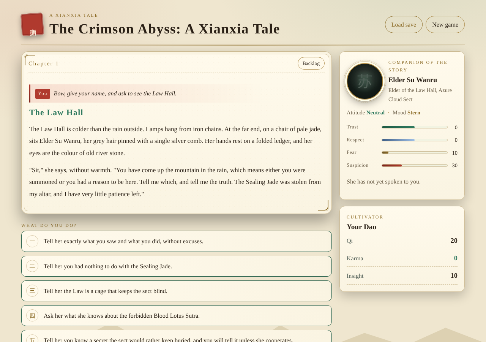
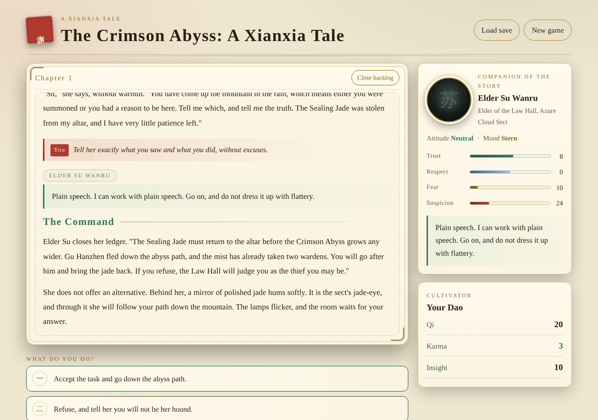
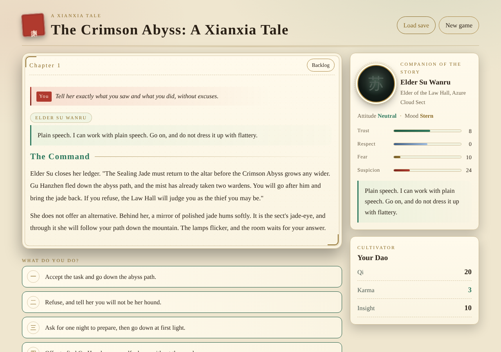
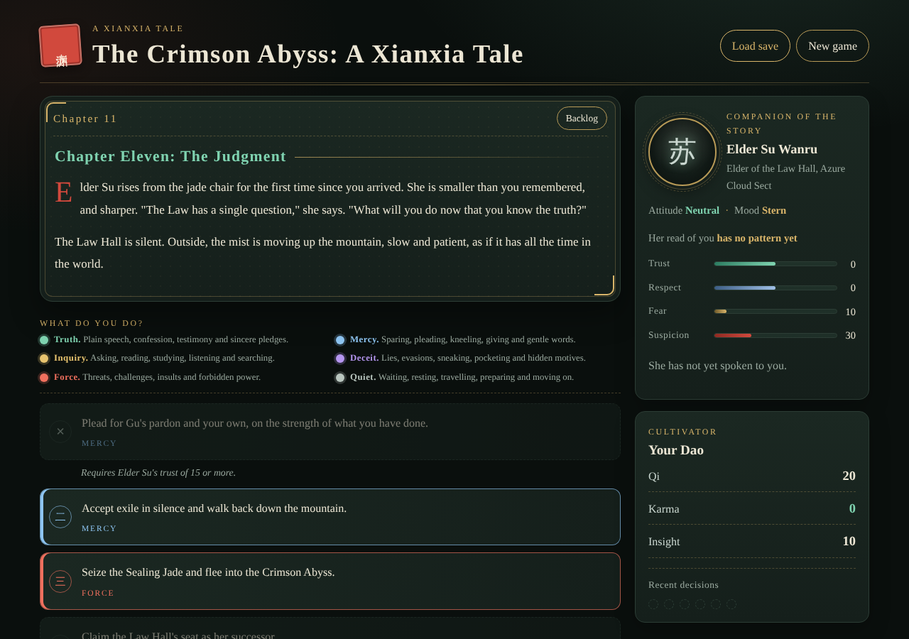
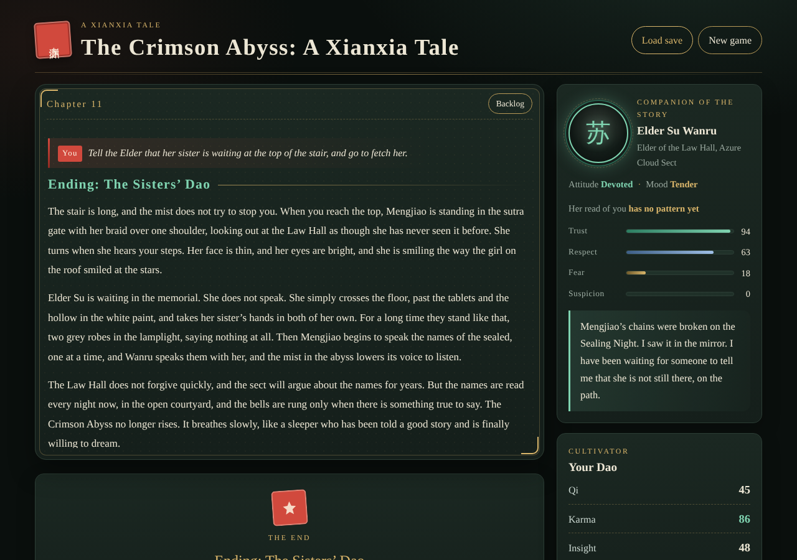
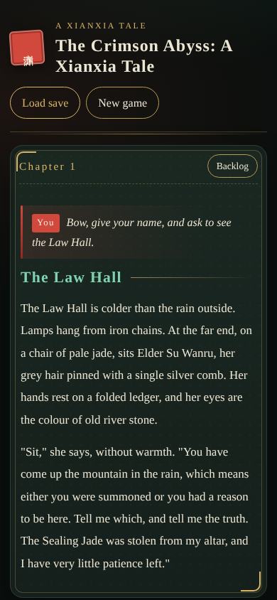
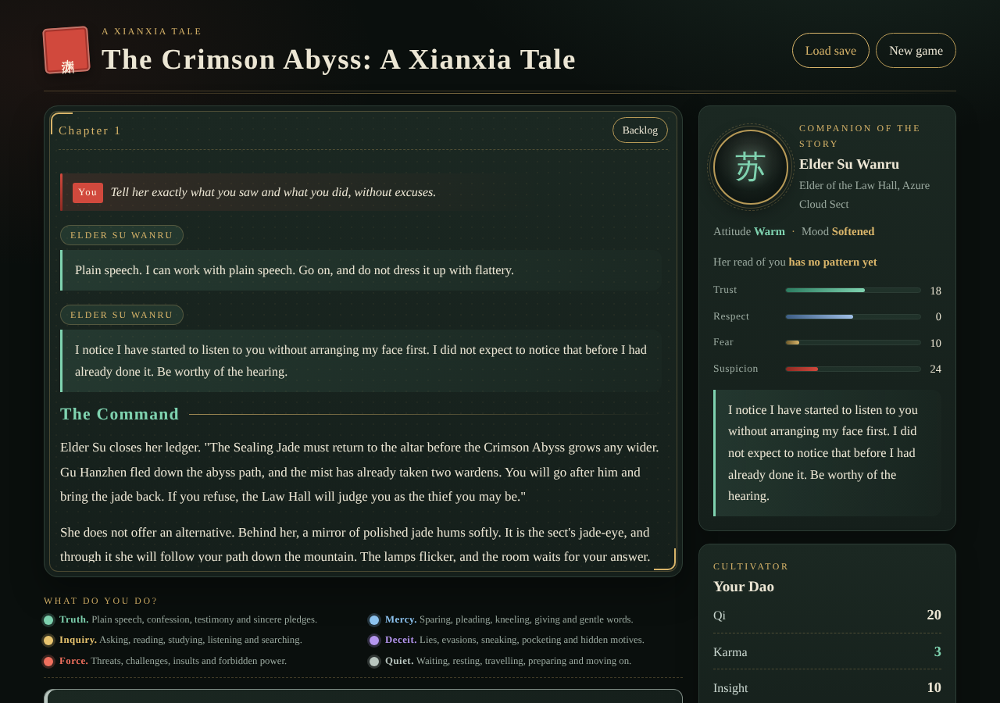
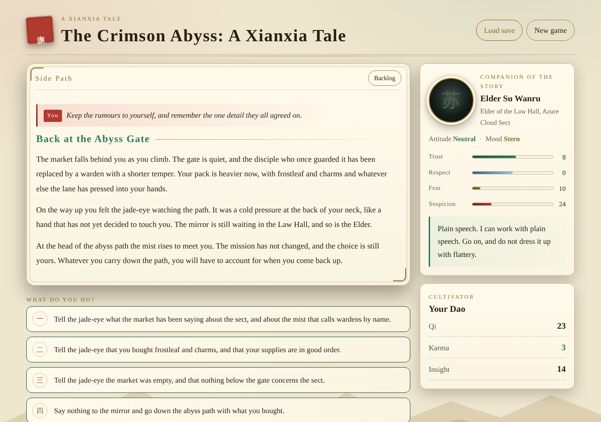
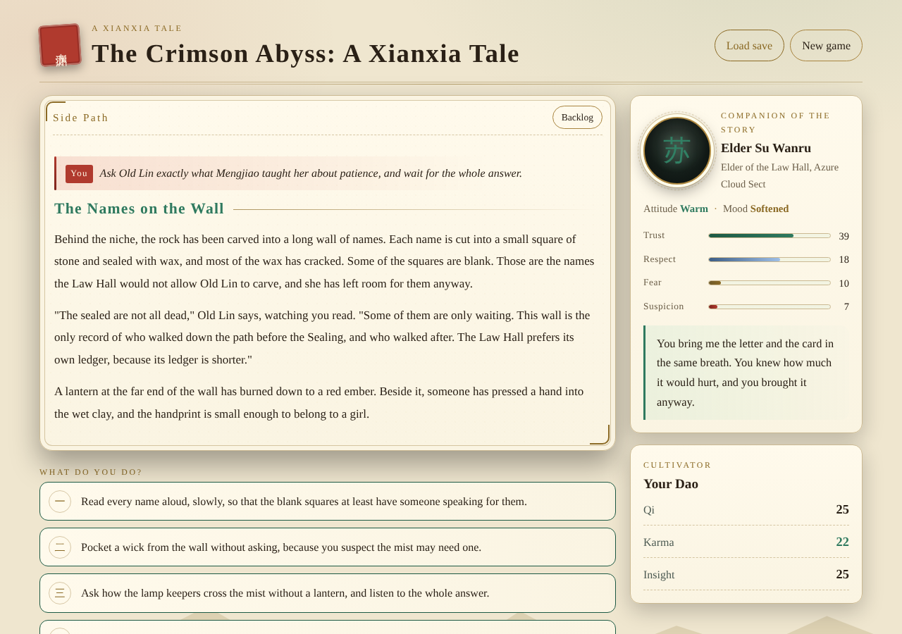
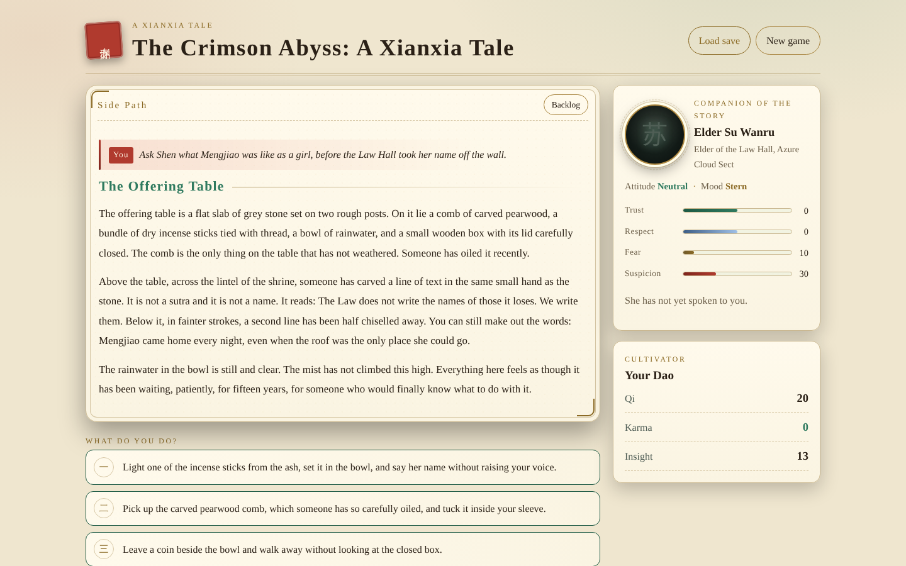
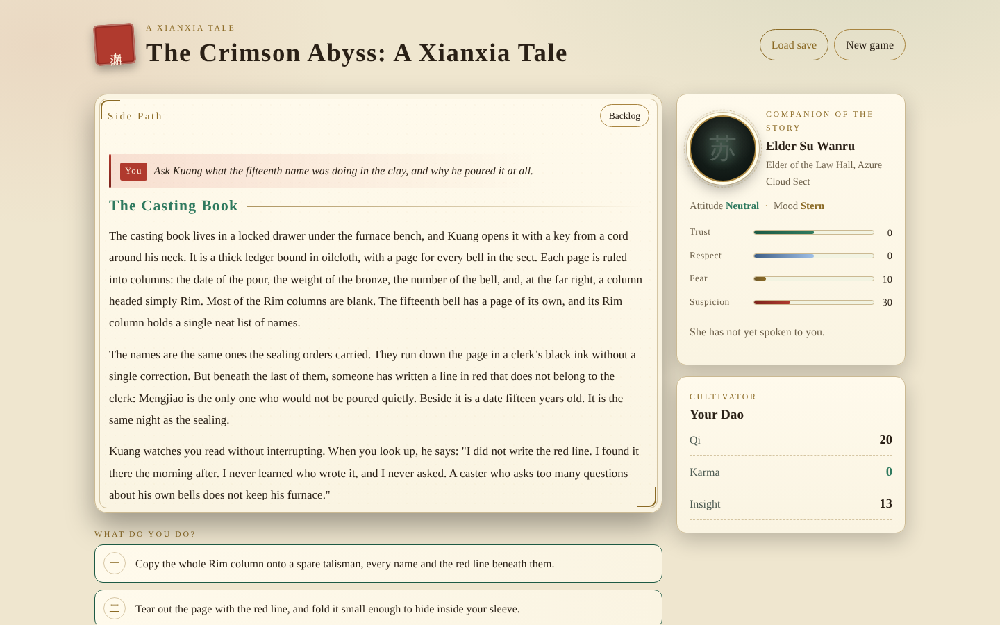
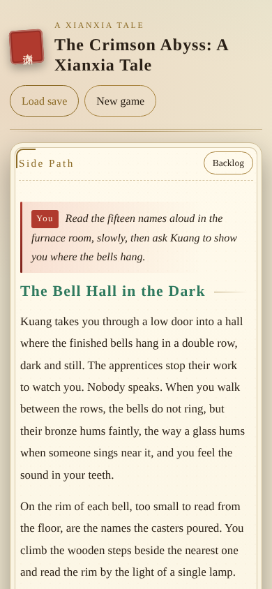
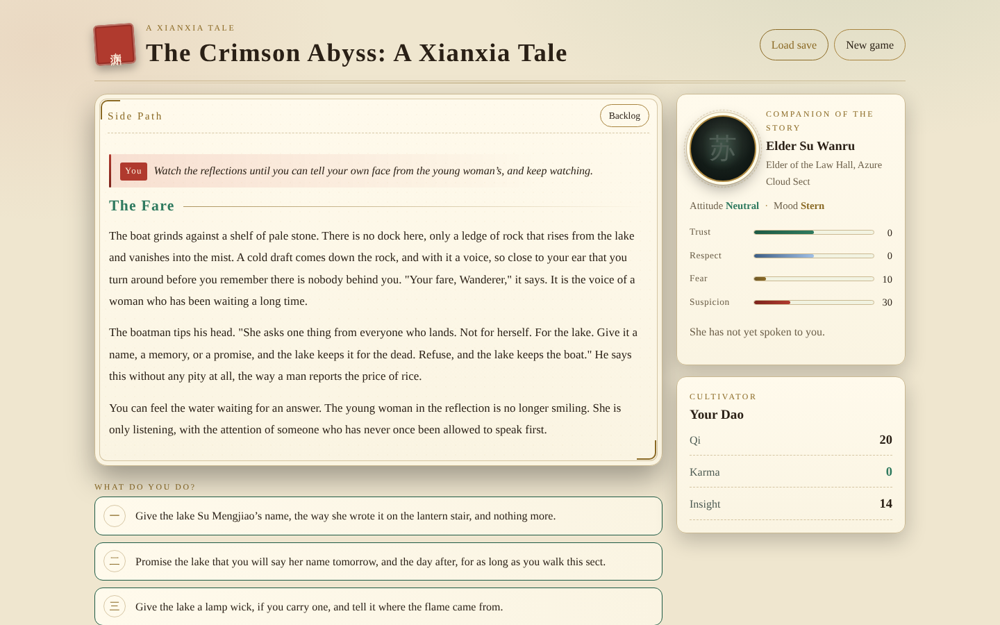
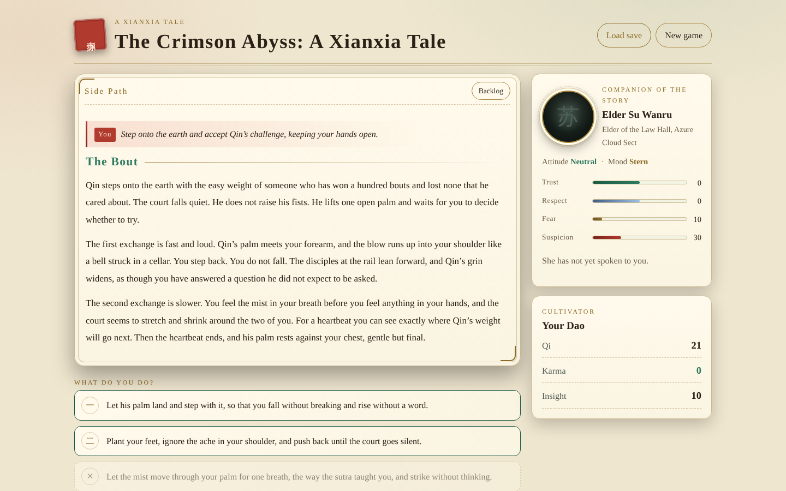
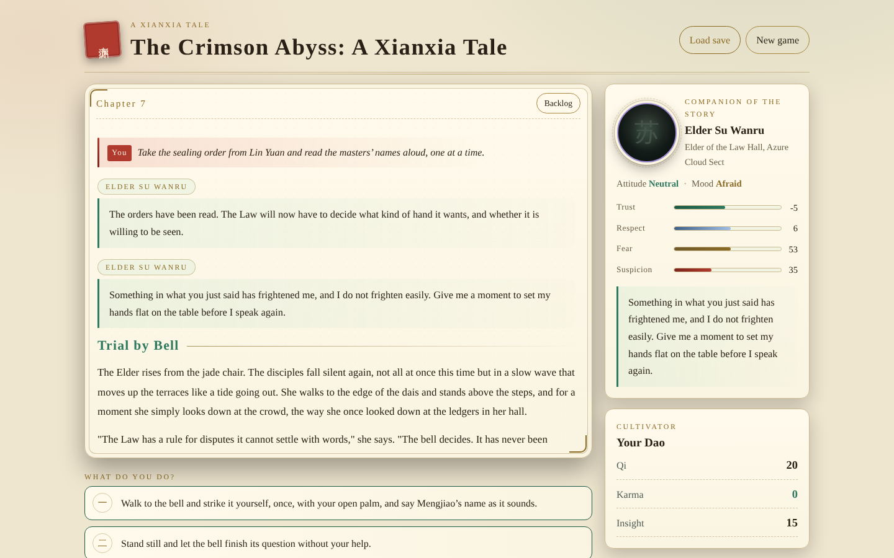
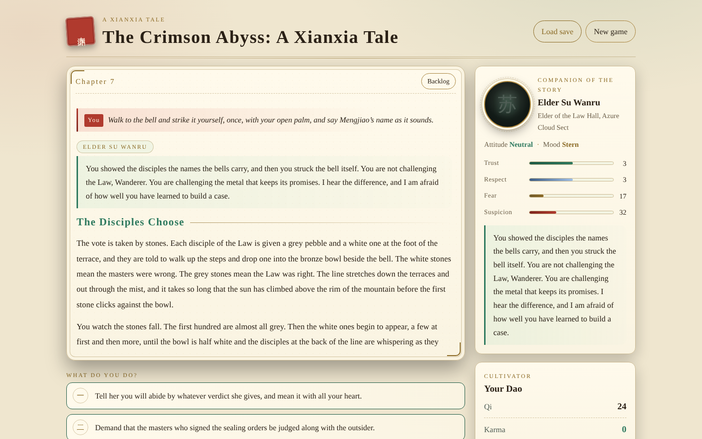

## Getting started

```bash
npm install
npm run dev        # http://localhost:3000
```

## Scripts

| Command | What it does |
| --- | --- |
| `npm run dev` | Start the dev server |
| `npm run build` / `npm start` | Production build and server |
| `npm test` | Story integrity, NPC reaction, word cap, and save tests |
| `npm run typecheck` | `tsc --noEmit` |
| `npm run lint` | ESLint (Next.js rules) |
| `npm run word-count` | Words written so far, by chapter, against the 1,000,000-word goal |

## Project layout

See [docs/ARCHITECTURE.md](docs/ARCHITECTURE.md) for diagrams of the engine, turn flow, NPC attitude and mood model, reaction memory, the body-text cap, the chapter map, and the scenario table.

```
src/engine/   pure story logic: state, NPC reactions and memory, validation, saves, word counting
src/story/    chapters, side paths, and the Elder's scenarios (content lives here)
src/components/  React UI
app/          Next.js routes and layout
tests/        vitest suites
scripts/      word-count tool
```

## Status

The engine, NPC system, visual novel UI, and eleven chapters are in place: the original three-part storyline plus eight new chapters (Ash Archive, Sutra Door, Blood Lotus Sutra, Jade Eye, Tribunal of Bells, Second Descent, Mist Remembers Mengjiao, Sealing Night). Six side paths branch from the main line: the Herb Market, the Lantern Stair, the Sister’s Shrine, the Sparring Court, the Bell Foundry, and the Ferry of Still Water.

The story is about 38,900 words, which is **3.89%** of the 1,000,000-word goal. Adding content means adding scenes to `src/story/chapter-*.ts` or a new side-path file, registering new chapters in `src/story/index.ts`, and the validator and word count update automatically. Every new paragraph and NPC line must stay at 200 words or fewer.
