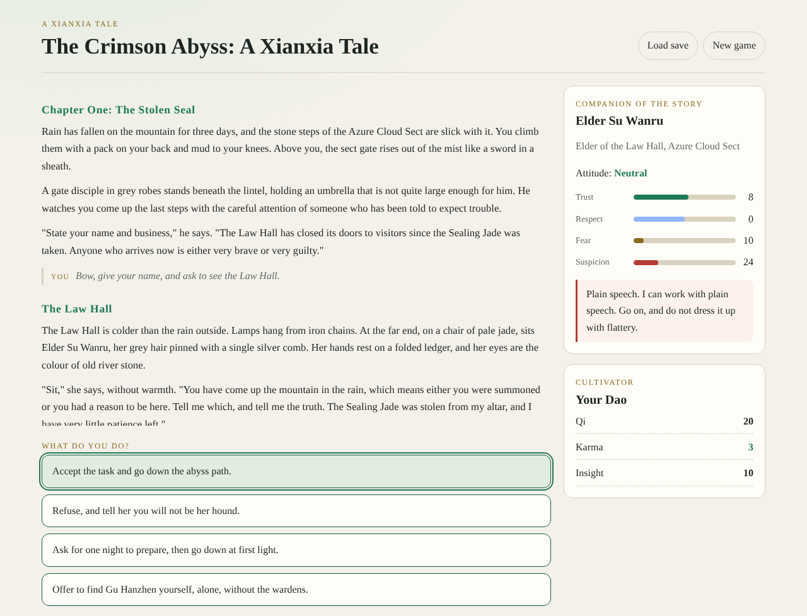
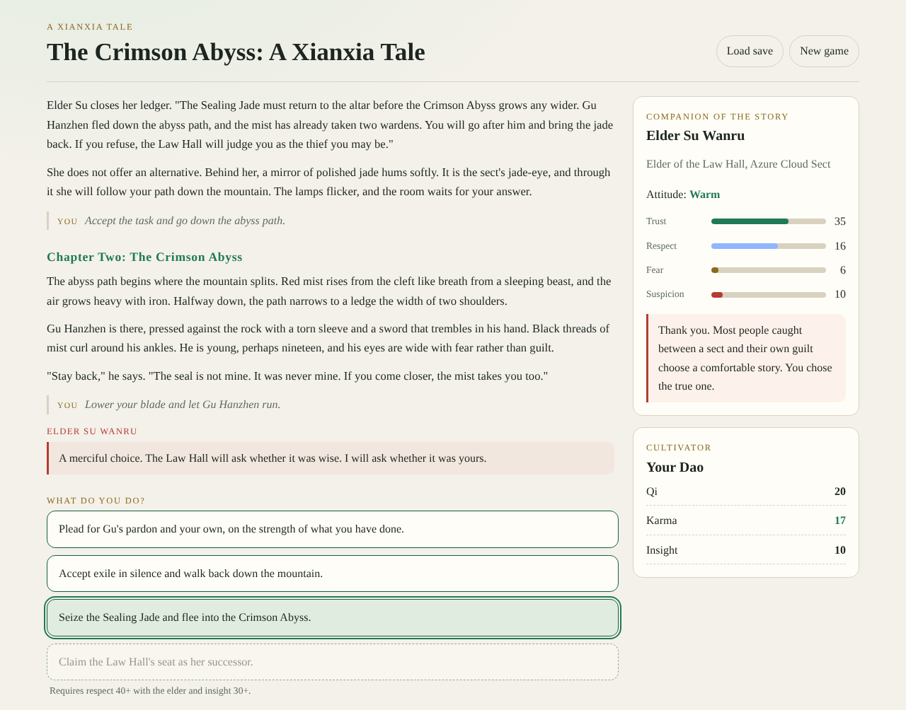
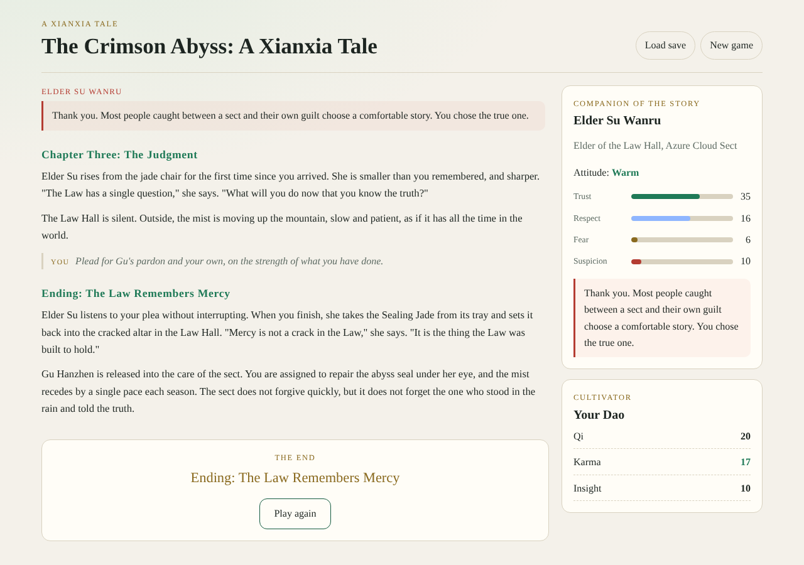
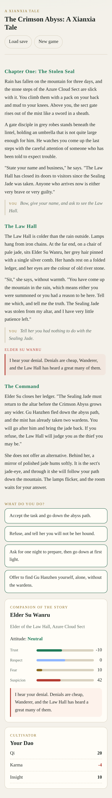

# The Crimson Abyss — a xianxia text adventure

A text adventure built with Next.js and TypeScript. You arrive at the Azure Cloud Sect after the Sealing Jade is stolen. Elder Su Wanru remembers everything you say and do, and her attitude changes how she responds to each later scenario.


## Features

- **Reactive NPC.** Elder Su has 15 scenarios. Each one has five lines chosen by her trust level. Earlier choices can override the line through memory flags, so a lie in Chapter One comes back when you tell the truth later.
- **Four or more options at every decision.** Options with unmet requirements stay visible, marked, and explain what is missing.
- **Multiple endings.** Four endings depend on trust, respect, insight, and your choices. One refusal ends the story early.
- **Saves in your browser.** Progress is written to `localStorage` after every choice. Storage errors never stop play.






## Getting started

```bash
npm install
npm run dev        # http://localhost:3000
```

## Scripts

| Command | What it does |
| --- | --- |
| `npm run dev` | Start the dev server |
| `npm run build` / `npm start` | Production build and server |
| `npm test` | Story integrity and NPC reaction tests |
| `npm run typecheck` | `tsc --noEmit` |
| `npm run lint` | ESLint (Next.js rules) |
| `npm run word-count` | Words written so far against the 1,000,000-word goal |

## Project layout

See [docs/ARCHITECTURE.md](docs/ARCHITECTURE.md) for diagrams of the engine, turn flow, NPC attitude model, and scenario table.

```
src/engine/   pure story logic: state, NPC reactions, validation
src/story/    chapters and the Elder's scenarios (content lives here)
src/components/  React UI
app/          Next.js routes and layout
tests/        vitest suites
scripts/      word-count tool
```

## Status

The engine, NPC system, UI, and one complete storyline (three chapters, four endings, 15 NPC scenarios) are in place. The current story is about 3,900 words, which is **0.39%** of the 1,000,000-word goal. Adding content means adding scenes to `src/story/chapter-*.ts`. The validator and word count update automatically.
