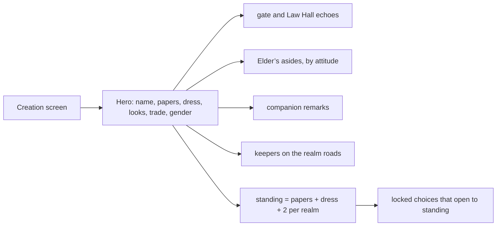
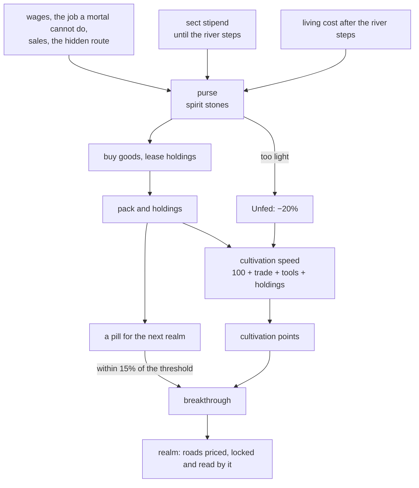
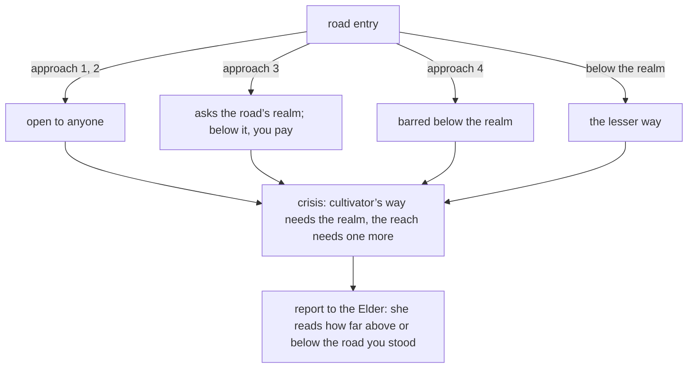
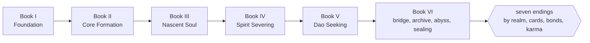

# The Crimson Abyss — a xianxia text adventure

A text adventure built with Next.js and TypeScript. You arrive at the Azure Cloud Sect after the Sealing Jade is stolen. Elder Su Wanru remembers everything you say and do, and her attitude changes how she responds to each later scenario.


## Features

- **Wealth, a pack, holdings and cultivation speed.** Spirit stones are the coin of the whole story. You start with a purse that your papers and your trade set, the sect pays you a stipend while you live on its mountain, and the morning the barge leaves the river steps it stops: from then on you pay your own keep, and a cultivator above Qi Condensation eats stones. Goods in your pack (a lamp, a mat, a charm, a seal) and holdings you lease (a stall, a bench, a cave) quicken your cultivation, a pill carries you over the next realm’s threshold, and a purse too light for your keep makes you Unfed and a fifth slower. Every choice that spends or earns shows its price before you pick it.
- **Forty Fortune Roads, 1,025 more scenes.** Ten new waysides, one at each of ten places the main line stops, from the stalls at the foot of the gate stair to the fair at the foot of the mountain. Each has four roads of 25 scenes, each written in its own words: twenty situations, a hidden route, a way back, and a keeper who sells one good and leases one holding. Prices follow the road’s realm. A pill is sold only to a hero of the road’s realm, a lease only to a hero who has it, and the job a mortal cannot do pays three days’ wages to a hero who can.
- **Accounts on the road.** Five short scenes stop the company at the river steps and the gates of Books Three to Six to count: the Elder reads your realm against what the road expects, notes if you are Unfed or quick, and lets you spend, share or sit the night. Each of the seven endings closes on the purse and the holdings.
- **Goods that stand in for a realm.** At three of Book Six’s wards a charm, a seal or a shard of glass takes the place of one realm. Each is used up by the choice that spends it.
- **1,743 more plot holes fixed.** See [docs/PLOT_HOLES.md](docs/PLOT_HOLES.md). 1,678 are lines a player read twice in one walk of a road (the generated roads gave the same menu line and the same second paragraph to every scene of an approach), and 64 contradict the story’s setting, the hero’s realm, dress or purse. The ledger says which is which.
- **Make your character.** Before the first scene you choose a name, the papers you travel under (outcast, commoner, gentry, noble), what you wear, your looks, the life you led since the river village, and your gender. Each is something an NPC can see, and each changes what they say: the gate disciple reads your dress and papers, Elder Su comments on you every few decisions (22 observations by 5 attitudes, plus one for each stretch of your cultivation), 66 companion remarks wait for the right person to be met, and every keeper on the new roads reads your dress, birth, trade, face and manner. None of it changes what you can do. Cultivation does that.
- **Standing.** Papers and dress set a floor, and every realm adds two, so a Foundation Builder born an outcast already outranks a mortal prince. Some doors open to standing alone.

- **Visual novel stage.** Each choice clears the screen to the new beat. Earlier text stays out of view until you open the backlog.
- **No Continue. Every scene fits one screen.** A scene’s body text, every extra paragraph and every NPC interjection included, stays at 200 words or fewer, and so does every NPC line. There are no page turns: a long stretch of the story is broken into scenes, and each scene ends in choices. The test suite fails if a cap is broken or a scene has no heading.
- **Coloured choices.** Every decision has one of six tones: truth (jade), mercy (sky blue), inquiry (gold), deceit (violet), force (cinnabar) and quiet (grey). Each option wears its colour and names its tone, and a legend above the options explains them, so colour is never the only cue.
- **Four or more options at every decision.** Options with unmet requirements stay visible, marked, and explain what is missing.
- **The realm matters, more.** Forceful choices in Book One now ask the realm of their chapter, and a mortal who forces a ward pays for it. Forty new realm roads in Books Two to Six bar their deep approach below the road’s realm, charge for a reach above it, offer a lesser way to a traveller who is not equal to the place, and have their keepers greet a hero a realm below, at or above the road differently.
- **The realm matters.** Cultivation is paced across six books and gates the story. Routes lock behind a realm (the Ash Bridge bows only to Spirit Severing, the abyss doors read only Dao Seeking), a choice tagged “beyond you” costs cultivation, qi and the Elder’s respect if you take it too early, and a deed far below your realm earns mastery. Every hub has a night of meditation. Seven endings depend on realm, the nine cards, the friends you kept and your karma.
- **Cultivation.** You arrive as a **Mortal**. Every decision earns cultivation points (patience, study, truth and mercy earn more than force or lies), and enough points break you through eight realms: Mortal, Qi Condensation, Foundation Establishment, Core Formation, Nascent Soul, Spirit Severing, Dao Seeking and Ascendant. A breakthrough is logged on the stage and the Elder remarks on it. From Core Formation on, a heart demon holds back anyone whose karma has sunk below −30. Realms open a locked “cultivator’s way” at the crisis of every side road, and the Elder answers a cultivator differently from a mortal.
- **Forty realm roads, 1,020 more scenes.** Ten waysides open from the hubs of Books Two to Six (tollhouses, a lamp exchange, a Garrison bell, a ship fused in the Glass Sea, a teahouse on the mountain road). Each road is 25 scenes written in its own words: twenty situations, a hidden route and a way back.
- **Forty side roads, 1,010 new scenes.** Ten waysides branch off the main line, one per chapter from the gate to the sealing night, and each offers four roads. A road has an entry, four approaches of five scenes (each approach has its own tone), a hidden route of three scenes behind a high enough Insight, and a return scene that reports to the Elder. Every road is built from a short spec in `src/story/roads/` plus shared wording, so adding a road means adding one entry.
- **A reactive Elder.** Elder Su has 98 scenarios. Each one has five lines chosen by her trust level, and every one has at least one memory override that reads what the player has done. Earlier choices override lines through memory flags, so a lie in Chapter One comes back later. She remembers what she has just heard, and she keeps count of the tones you choose: after three of your last four decisions share a tone, she names that manner once. Her respect for you now matters too: when it moves into a new band (contempt, unregarded, weighed, respected), she says so. Her panel shows her read of you, her attitude, her mood and her stats. She speaks unprompted when her suspicion, fear, a pattern in your past choices or a run of tones crosses a threshold, and in the return scenes of the side paths. She also reads your cultivation: she comments on mortals at the Law Hall and the abyss, names each breakthrough, answers a cultivator’s confession or threat differently from a mortal’s, and remarks on how many roads you have walked. Each road report has memory lines for the secret you found, the relic you kept, a run of lies, many roads walked and a cultivator’s standing.
- **Twelve side paths.** Seven were already in the story: the herb market, the pavilion of stone wagers, the lantern stair, the sister’s shrine, the sparring court, the bell foundry and the ferry of still water. Five are new: the foothill village where Gu Hanzhen was born, the quarry under the archive where the jade was cut, the healer’s hall where the calm dust is made, the old master on the eastern peak, and the rope bridge over the Cloud Gap. Each of the five branches into four approaches, has a hidden route, rejoins the main line, and ends with a report to the Elder.
- **Multiple endings.** Five endings depend on trust, respect, insight, and your choices. One refusal ends the story early.
- **Saves in your browser.** Progress is written to `localStorage` after every choice. Storage errors never stop play. Saves from before the Elder kept a reaction history, or before decisions had tones, still load.


### Your character




### Purse, pack, holdings and speed





### The realm roads





### Realm gates, strain and endings




### Cultivation and the side roads


## Getting started

```bash
npm install
npm run dev        # http://localhost:3000
```

## Scripts

| Command | What it does |
| --- | --- |
| `npm run dev` | Start the dev server |
| `npm run build` / `npm start` | Production build and server |
| `npm test` | Story integrity, choice tones, scene and line caps, respect and NPC reactions, side paths, the 3,000 road scenes, cultivation realms, the purse, pack, holdings and speed, all 120 roads walked for repeats and the 40 Fortune Roads walked in full, saves |
| `npm run typecheck` | `tsc --noEmit` |
| `npm run lint` | ESLint (Next.js rules) |
| `npm run word-count` | Words written so far, by chapter and side path, against the 1,000,000-word goal |
| `npm run check` | The validator and the continuity audit (dangling flags, dead conditions, time loops) |
| `npx tsx scripts/audit-slots.ts` | Counts the Book One road lines whose old wording did not fit what it named (686) |
| `npm run simulate -- 40 diligent` | Random-walks the story (`thorough`, `diligent`, `forceful`, `hasty`, `merchant`) to find soft-locks and report realm, ending, purse and speed |

## Project layout

See [docs/ARCHITECTURE.md](docs/ARCHITECTURE.md) for diagrams of the engine, turn flow, choice tones, the scene cap, the NPC attitude, respect, manner and memory models, the side path map, the chapter map and the scenario table.

```
src/engine/      pure story logic: state, tones, cultivation realms, the purse, pack, holdings and speed, NPC reactions and memory, validation, saves, word counting
src/story/       chapters, side paths, the generated side roads, the realm roads, the Fortune Roads, the accounts on the road, and the Elder’s scenarios (content lives here)
src/components/  React UI: the stage, the tone legend, the NPC, cultivation, purse and stats panels
app/             Next.js routes, layout and styles
tests/           vitest suites
scripts/         word count, story check, simulator
```

## Status

The engine, NPC system, cultivation realms, visual novel UI, six books and their endings are in place and playable from the first scene to seven endings. Every scene stands on its own: no page turns, a heading on every scene, four or more tone-tagged choices at every decision, and a 200-word cap on every scene body.

The story has 5,881 scenes (9 endings) and 25,951 choices, with 256 NPC scenarios and 262 unprompted remarks. The word count is 1,369,319, which is **136.9%** of the 1,000,000-word goal. The count adds up every variant of a line that can be shown (every dress, birth and realm a keeper can react to), so it overstates what one playthrough reads. See [docs/PLOT_HOLES.md](docs/PLOT_HOLES.md): this pass fixed 1,743 inconsistencies, of which 64 contradict the setting, the hero or the purse and 1,678 are lines a player read twice, and the ledger says plainly which is which.

The side roads of Book One are assembled from templates and read more uniformly than the hand-written chapters. The Book V finale and Book VI are compact (about 8,000 words) next to the sixteen-arc hubs before them, and are the obvious place to add more. The books and the canon are described in [docs/CANON.md](docs/CANON.md). Adding content means adding an arc under `src/story/books/<book>/`, registering it in `src/story/books/index.ts`, and running `npm run check`.
