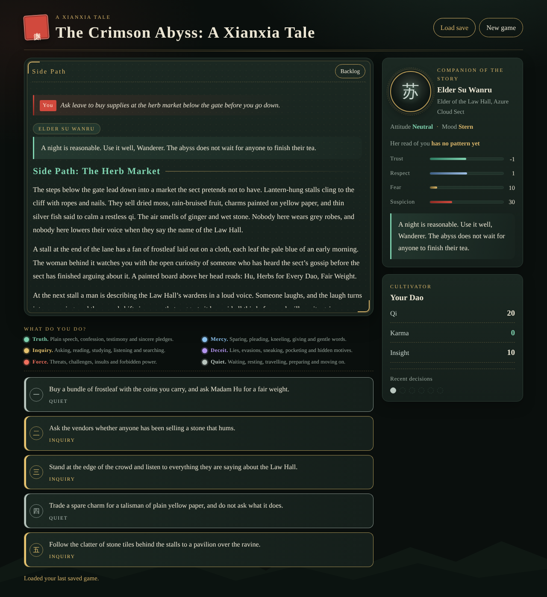
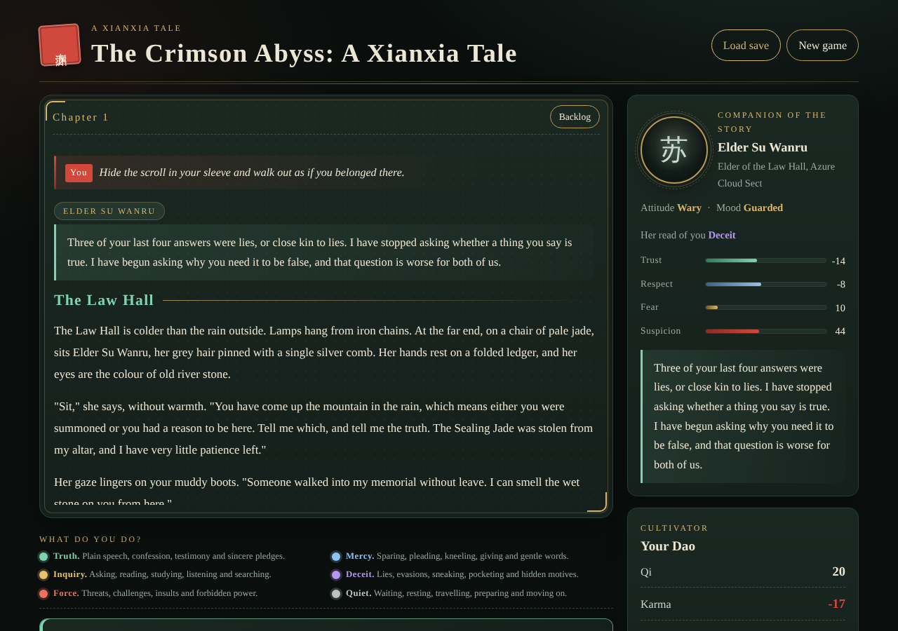
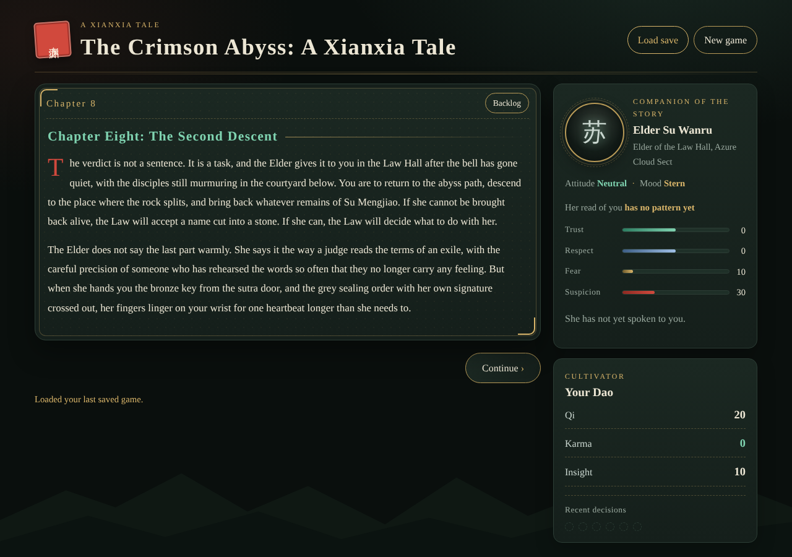
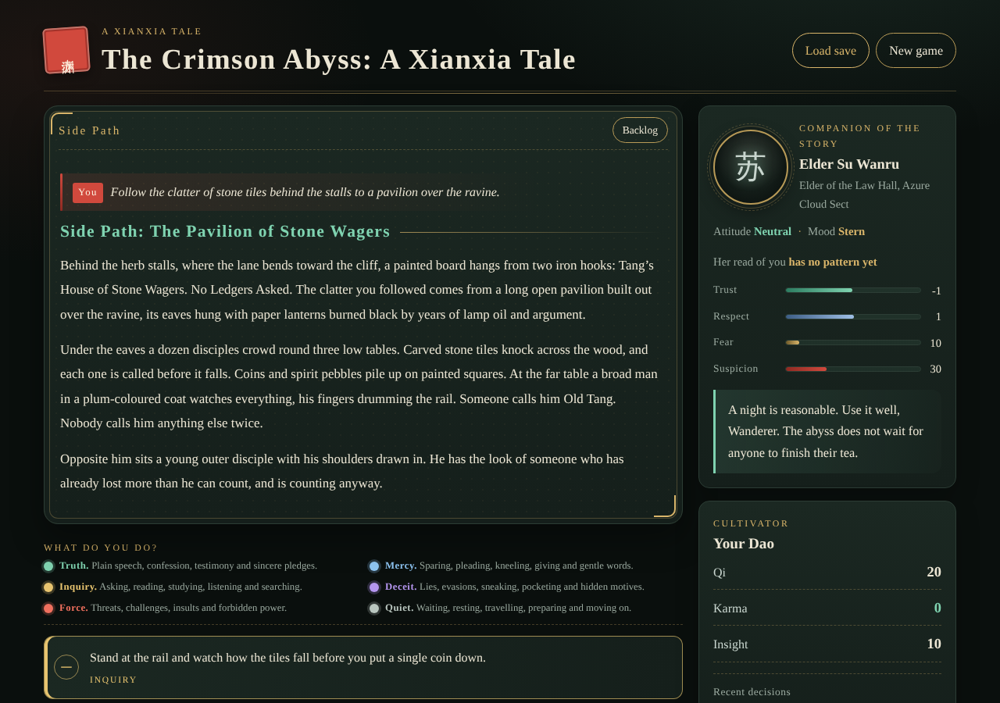
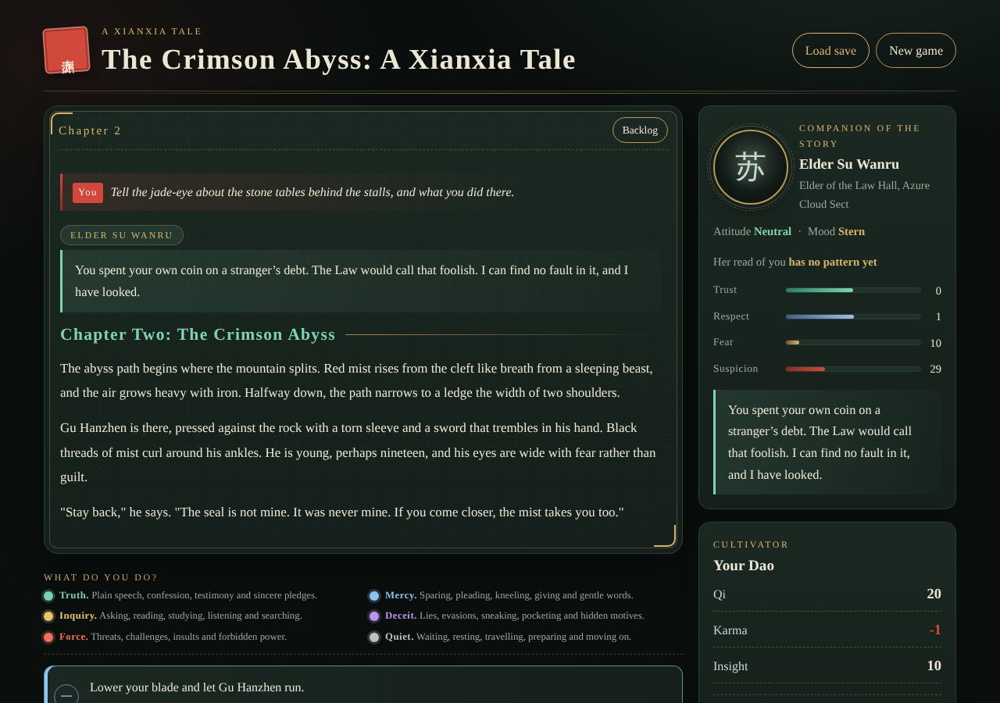
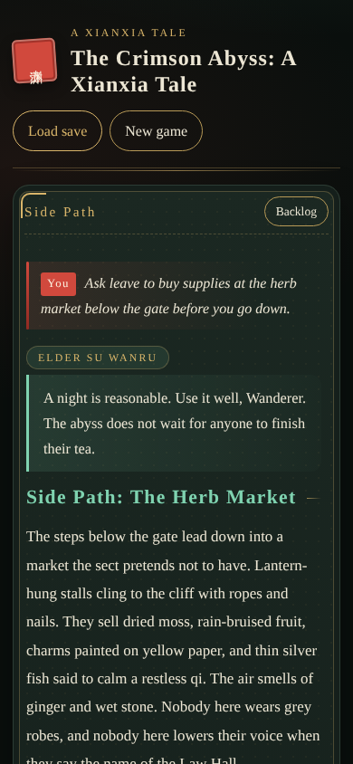

# The Crimson Abyss — a xianxia text adventure

A text adventure built with Next.js and TypeScript. You arrive at the Azure Cloud Sect after the Sealing Jade is stolen. Elder Su Wanru remembers everything you say and do, and her attitude changes how she responds to each later scenario.


## Features

- **Visual novel stage.** Each choice clears the screen to the new beat. Earlier text stays out of view until you open the backlog. A long scene runs on through Continue pages, so the reader turns the page instead of choosing.
- **Scenes capped at 200 words.** A scene's body text, every extra paragraph and every NPC interjection included, stays at 200 words or fewer, and so does every NPC line. A scene that runs longer is split into pages, each ending in a Continue button. The test suite fails if a cap is broken.
- **Coloured choices.** Every decision has one of six tones: truth (jade), mercy (sky blue), inquiry (gold), deceit (violet), force (cinnabar) and quiet (grey). Each option wears its colour and names its tone, and a legend above the options explains them, so colour is never the only cue.
- **Reactive NPC.** Elder Su has 51 scenarios. Each one has five lines chosen by her trust level. Earlier choices override lines through memory flags, so a lie in Chapter One comes back later. She remembers what she has just heard, and she now keeps count of the tones you choose: after three of your last four decisions share a tone, she names that manner once, and runs of lies, threats, mercy, questions or silence change how she answers. Her panel shows her read of you and the tones of your latest decisions. She comments when a choice moves her to a warmer or colder attitude, and when fear or suspicion changes her face. She speaks unprompted when her suspicion, fear, a pattern in your past choices or a run of tones crosses a threshold.
- **Side paths.** Seven optional detours branch from the main line and rejoin it. The herb market below the gate, where rumours can be carried back to the Elder. The pavilion of stone wagers behind the stalls, where a debt, a loaded tile and the wardens decide what she hears. The lantern stair under the sutra door, where a keeper remembers Mengjiao. The sister’s shrine behind the archive, where someone still keeps a light for her. The sparring court under the summons, where Qin tests the outsider. The bell foundry during the trial, where the names are poured into the bells. The ferry of still water before the sealing night, where the boatman takes a fare.
- **Four or more options at every decision.** Options with unmet requirements stay visible, marked, and explain what is missing.
- **Multiple endings.** Five endings depend on trust, respect, insight, and your choices. One refusal ends the story early.
- **Saves in your browser.** Progress is written to `localStorage` after every choice and page turn. Storage errors never stop play. Saves from before the Elder kept a reaction history, or before decisions had tones, still load.









## Getting started

```bash
npm install
npm run dev        # http://localhost:3000
```

## Scripts

| Command | What it does |
| --- | --- |
| `npm run dev` | Start the dev server |
| `npm run build` / `npm start` | Production build and server |
| `npm test` | Story integrity, choice tones, scene and line caps, NPC reactions, pages and save tests |
| `npm run typecheck` | `tsc --noEmit` |
| `npm run lint` | ESLint (Next.js rules) |
| `npm run word-count` | Words written so far, by chapter, against the 1,000,000-word goal |

## Project layout

See [docs/ARCHITECTURE.md](docs/ARCHITECTURE.md) for diagrams of the engine, turn flow, choice tones, scene pages, the NPC attitude, manner and memory models, the length caps, the chapter map, and the scenario table.

```
src/engine/      pure story logic: state, tones, NPC reactions and memory, validation, saves, word counting
src/story/       chapters, side paths, and the Elder's scenarios (content lives here)
src/components/  React UI: the stage, the tone legend, the NPC and stats panels
app/             Next.js routes, layout and styles
tests/           vitest suites
scripts/         word-count tool
```

## Status

The engine, NPC system, visual novel UI, and eleven chapters are in place: the original three-part storyline plus eight new chapters (Ash Archive, Sutra Door, Blood Lotus Sutra, Jade Eye, Tribunal of Bells, Second Descent, Mist Remembers Mengjiao, Sealing Night). Seven side paths branch from the main line: the Herb Market, the Pavilion of Stone Wagers, the Sister’s Shrine, the Lantern Stair, the Sparring Court, the Bell Foundry, and the Ferry of Still Water.

The story has 187 scenes: 100 decision scenes, 82 continuation pages and 5 endings. It offers 414 decisions, each with a tone, and 51 NPC scenarios. It is about 42,242 words, which is **4.22%** of the 1,000,000-word goal. Adding content means adding scenes to `src/story/chapter-*.ts` or a side-path file, registering new chapters in `src/story/index.ts`, and the validator and word count update automatically. Every decision needs a tone, every new paragraph and NPC line must stay at 200 words or fewer, and every scene body (narration, extras and interjections together) must stay at 200 words or fewer. A longer scene is split into pages linked by Continue.
