# Architecture

The game is split into a pure story engine and a thin React shell. The engine has no React or DOM dependencies, so every rule is covered by unit tests.

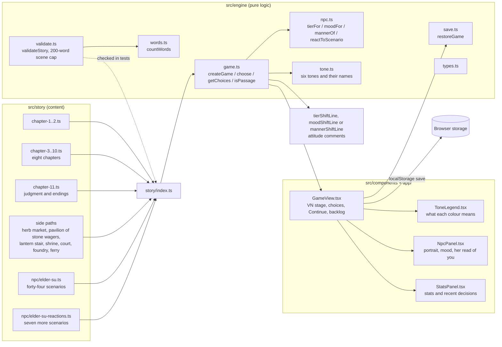

## Turn flow

Every choice goes through the same path. A decision logs the player's line, records its tone, and lets the NPC react before the next scene is entered, so her line is the last thing the player reads before the new text. A page turn does none of that: it only carries the reader on through a long scene.

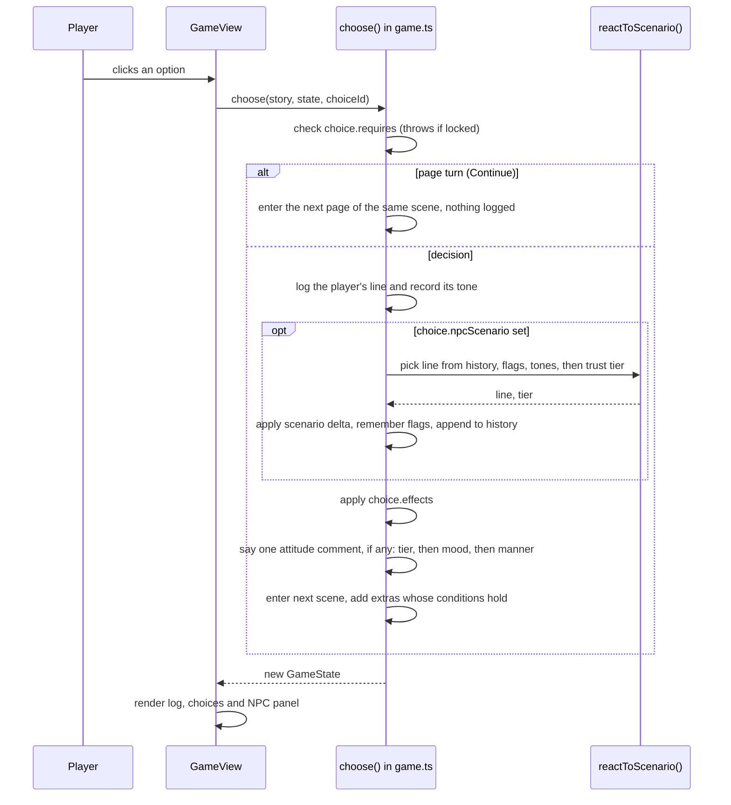

## Choice tones

Every decision has one of six tones. The tone sets the colour of the option, its tag, and its dot in the player's recent decisions. The Elder keeps count of the tones too, so a pattern of decisions changes what she says. A page turn has no tone, because it is not a decision.

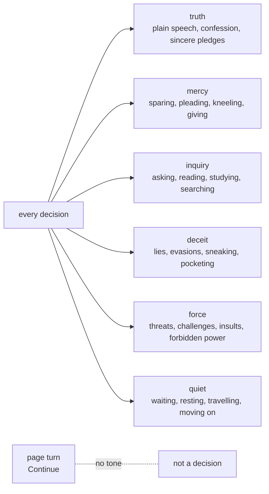

## Scene cap and pages

A scene's body text is every paragraph, every extra paragraph and every NPC interjection, counted all at once, because any of them can show. That total is capped at 200 words. A scene that runs longer is split into pages. Each page but the last ends with a Continue page turn, and the last page holds the choices, the ending if there is one, and the interjections. The first page keeps the scene's id, so every link into the scene still lands on its opening text.

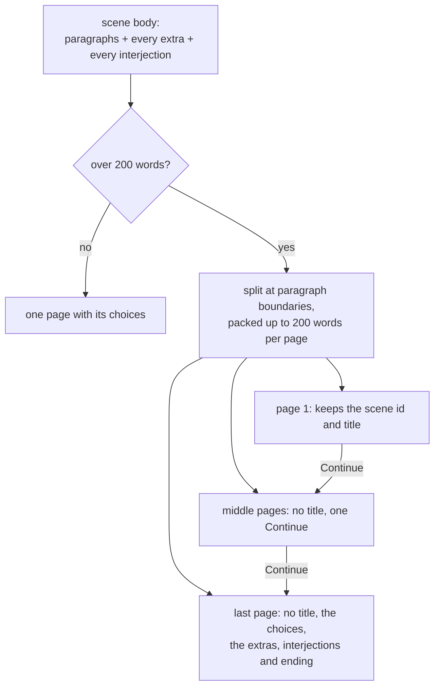

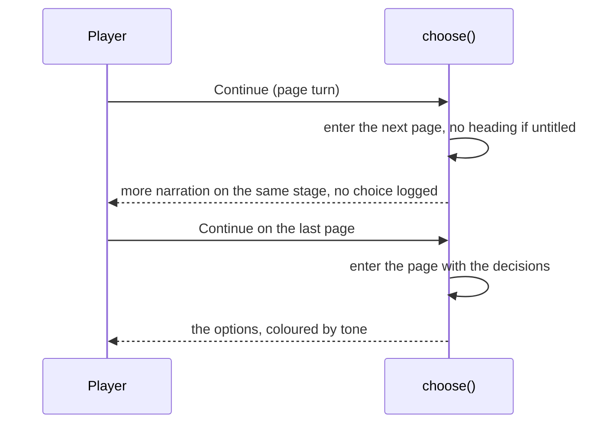

## NPC attitude model

Trust chooses the tier. Memory flags can override the tier line when the NPC remembers something the player did earlier, and the reaction history and recent tones can override it when she has just heard something or the player has been choosing in a pattern (see below).

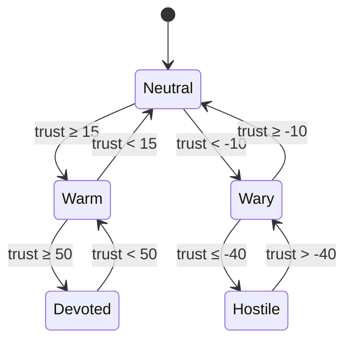

Her face, the mood shown in her portrait, is trust unless fear or suspicion takes over. Fear of 50 or more makes her afraid, and suspicion of 65 or more makes her suspicious. Those two override the tier.

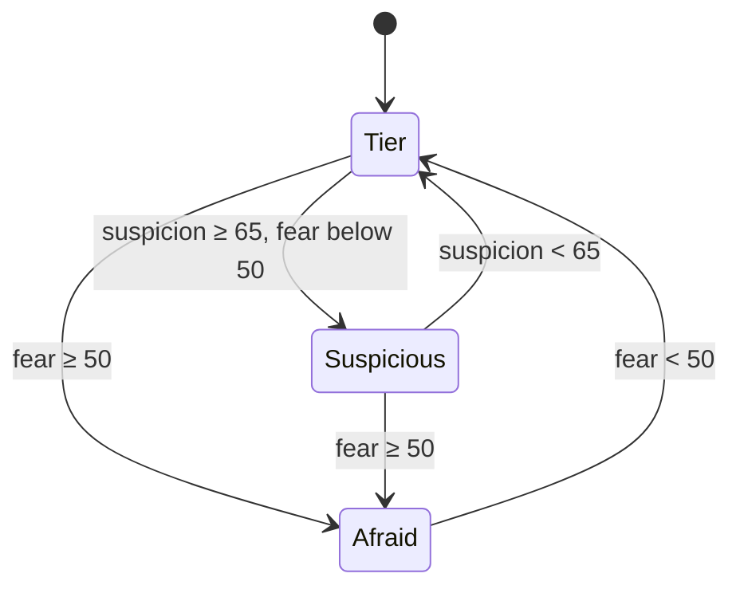

## Attitude shifts, manner and pattern interjections

When a choice crosses a tier boundary, the Elder speaks once more after her reply, so the change is the last thing the player reads. When only her face changes (fear or suspicion takes hold or lets go), she says so instead. When the player's recent decisions settle on one tone, she names that manner. Only one of these comments is said per choice, in that order. Scenes can also carry interjections whose conditions combine flags, her reaction history and the tones of the player's decisions, so she notices patterns in what the player has done.

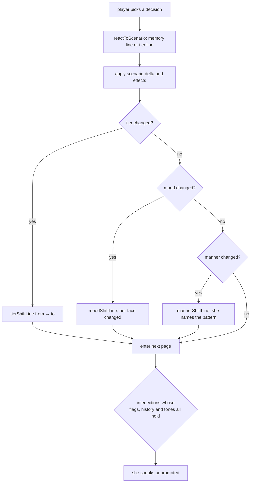

A manner is the tone that makes up at least three of the player's last four decisions. She names it once, when it first forms, so a steady pattern is not repeated on every choice.

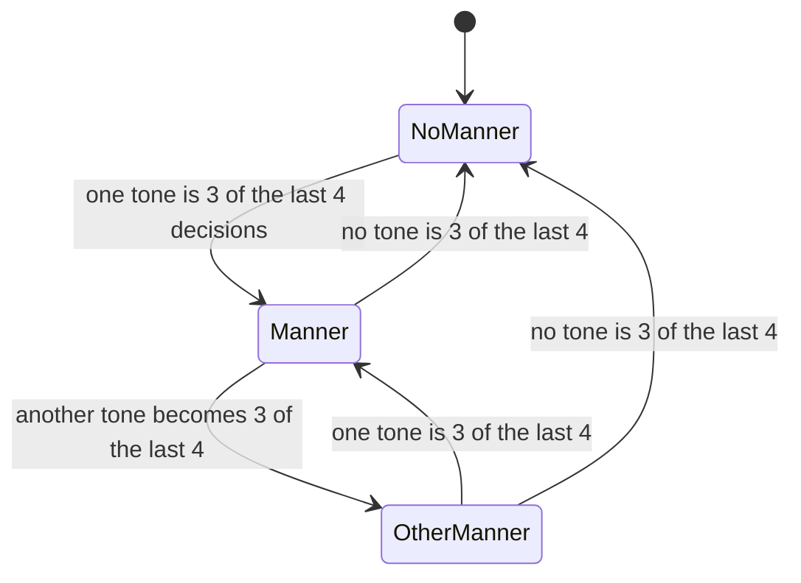

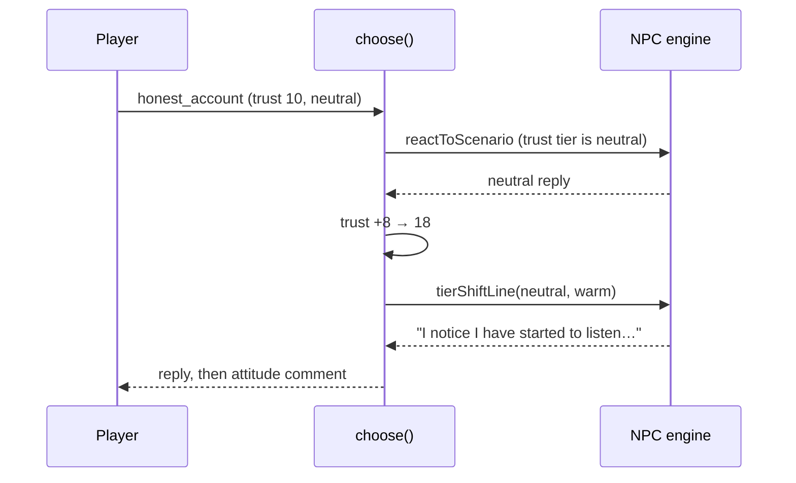

## Reaction memory

Every NPC scenario she reacts to is appended to `history`, in order. A `said` condition reads that list: `min` counts how many times a scenario appears, and `within` looks only at her last N reactions. `within: 1` is "what she just heard". A `tone` condition reads the same way over the tones of the player's decisions, so `min: 3, within: 4` is "three of the last four decisions were deceit". Memory overrides are checked in order, so flag memories written by earlier choices still win over the newer history and tone lines.

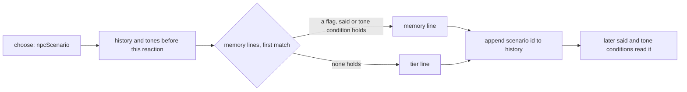

A contradiction is the clearest case. If the player tells the truth and then denies it with nothing else in between, the denial answers differently:

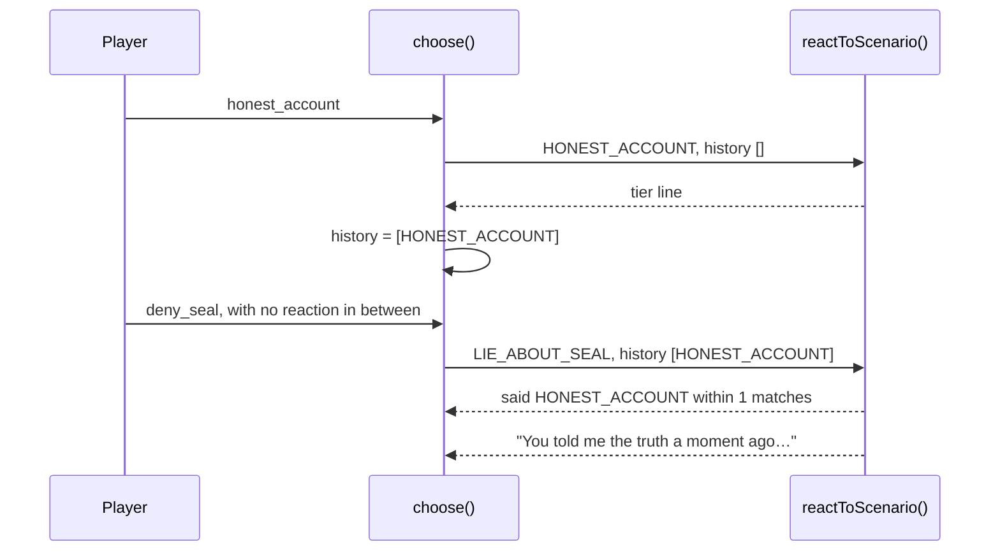

## Length caps

Every scene is capped at 200 words of body text, and so is every NPC line: each tier line, memory line and attitude comment. `validateStory` reports any scene or line over its cap, and the test suite fails until it is split or shortened. The count uses `countWords`, the same counter the word-count report uses.

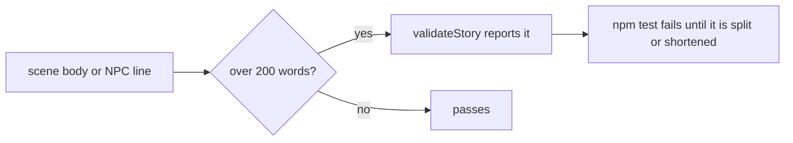

## Chapter map

Reading order is set in `src/story/index.ts`. Each chapter ends by linking into the next one's first scene. The judgment in chapter eleven has five endings, and the Sisters’ Dao ending needs Mengjiao freed on the Sealing Night. Seven side paths branch from the main line and rejoin it.

```mermaid
flowchart LR
  C1[1 The Stolen Seal] --> C2[2 The Crimson Abyss]
  C1 -. prepare at the market .-> SM[Side: The Herb Market] -. rejoins at the abyss path .-> C2
  SM -. follow the clatter .-> SP[Side: The Pavilion of Stone Wagers] -. rejoins at the market report .-> SM
  C2 --> C3[3 The Ash Archive]
  C3 -. ask the attendant .-> SS[Side: The Sister’s Shrine] -. rejoins at the sutra door .-> C4
  C3 --> C4[4 The Sutra Door]
  C4 -. follow the lamp keeper .-> SL[Side: The Lantern Stair] -. rejoins at the sutra hall .-> C5
  C4 --> C5[5 The Blood Lotus Sutra]
  C5 --> C6[6 The Jade Eye]
  C6 -. train in the court .-> SC[Side: The Sparring Court] -. rejoins at the summons .-> C7
  C6 --> C7[7 The Tribunal of Bells]
  C7 -. slip behind the dais .-> SF[Side: The Bell Foundry] -. back to the bell rule .-> C7
  C7 --> C8[8 The Second Descent]
  C8 --> C9[9 The Mist Remembers Mengjiao]
  C9 -. take the ferry .-> SW[Side: The Ferry of Still Water] -. rejoins at the hall .-> C10
  C9 --> C10[10 The Sealing Night]
  C10 --> C11[11 The Judgment]
  C11 --> E1[Long Road Down]
  C11 --> E2[Law Remembers Mercy]
  C11 --> E3[Black Lotus Blooms]
  C11 --> E4[Keeper of Bars]
  C11 --> E5[Sisters Dao]
  C10 -. freed Mengjiao .-> C11
```

## Visual novel stage

The stage shows only the current beat. `currentBeat` starts at the player's latest choice, so the previous scene is hidden. Continue pages add their text to the same beat, and the stage scrolls to the new text. The backlog shows the full log.

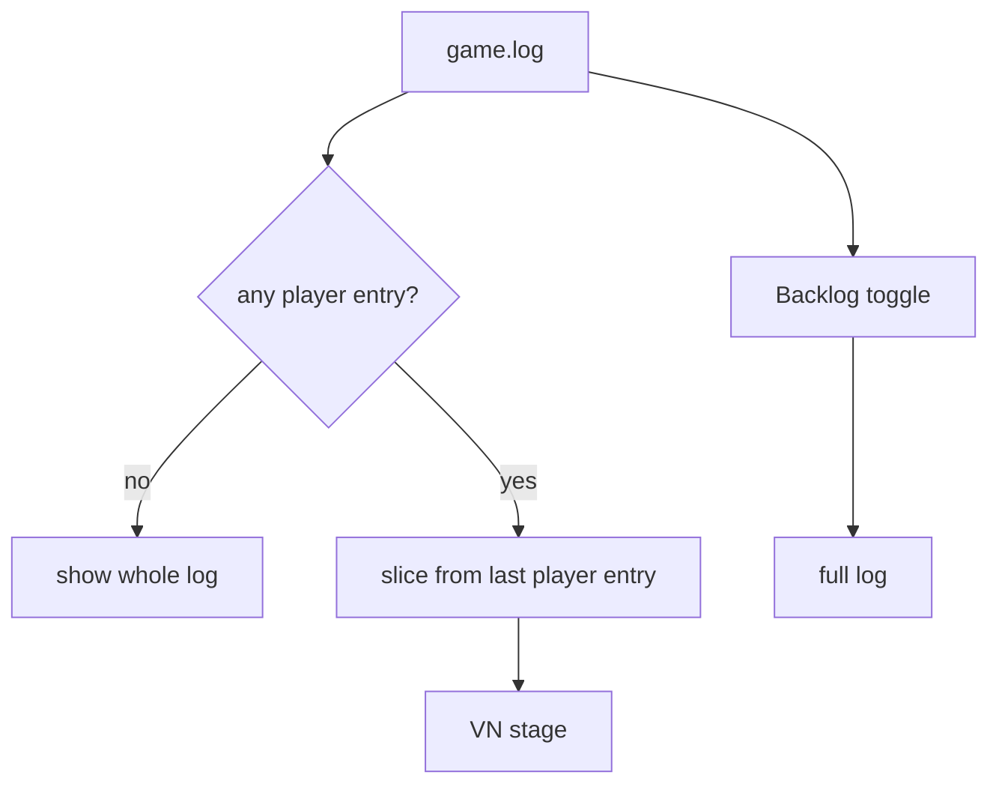

## Saves

A save is the whole `GameState` in `localStorage`, written after every choice and every page turn. Loading goes through `restoreGame`, which rejects a save that points at a scene the story does not have, and gives a save from before the reaction history or the decision tones an empty `history` or `tones`, so older progress still loads.

## Scenarios

The Elder reacts to fifty-one scenarios. Each has five tier lines. Some have memory overrides, and some of those match on what she has just heard (`said`), on the flags the player has set, or on the tones of recent decisions (`tone`). Scenes can also carry NPC interjections, which she speaks unprompted when her metrics, flags, history or tones cross a threshold. Her attitude-shift lines (eight of them), mood-shift lines (seven, one per mood) and manner lines (six, one per tone) sit in `src/engine/npc.ts`.

The scenarios are in `src/story/npc/elder-su.ts`, and the seven newest, which react to choices she used to let pass, are in `src/story/npc/elder-su-reactions.ts`: `REQUEST_NIGHT`, `OFFER_TO_FETCH_GU`, `PLEAD_FOR_PARDON`, `ACCEPT_EXILE`, `CLAIM_SEAT`, `SEIZE_JADE` and `REPORT_WAGER`. The table lists the scenarios whose memory overrides matter most to a playthrough, and the source has the rest.

| Scenario | Triggered by | Memory override |
| --- | --- | --- |
| GIFT_HERB | Offering a spirit herb at the gate | a run of deceit (`tone` deceit, 2 of the last 3) |
| HONEST_ACCOUNT | Telling the truth | `lied_about_seal`; a third honest account (`said`); a blade in the voice (`tone` force, 2 of the last 3) |
| LIE_ABOUT_SEAL | Denying the theft | the truth just before (`said` within 1); a run of lies (`tone` deceit, 3 of the last 4) |
| THREATEN | Threatening the elder | a third threat (`said` min 2); silence and then a threat (`tone` quiet, 3 of the last 4) |
| SHOW_MERCY | Sparing Gu Hanzhen | a threat just before (`said` within 1); a run of mercy (`tone` mercy, 3 of the last 4) |
| ASK_FORBIDDEN_ART | Asking about the Blood Lotus Sutra | a run of questions (`tone` inquiry, 3 of the last 4) |
| STEAL_SCROLL | Taking the Heavenly Scroll | — |
| REVEAL_DEMONIC_QI | Using the black lotus | — |
| INSULT_SECT | Mocking the Law | a repeated insult (`said` min 1) |
| HONOR_ANCESTORS | Kneeling at the tablets | — |
| REFUSE_TASK | Refusing the mission | `stole_scroll` |
| COMPLETE_TASK | Returning the jade | `spared_gu` |
| EXPOSE_HER_SECRET | Revealing Su Mengjiao | — |
| SWEAR_OATH | Swearing a Dao oath | `demonic_glimpsed` |
| ACCEPT_PUNISHMENT | Accepting judgment | `exposed_elder` |
| CHALLENGE_BELL_RULE | Striking the tribunal bell | the casting ledger just shown (`said` within 1) |
| SHOW_CASTING_LEDGER | Showing the names from the casting book | `tore_casting_page` |
| REPORT_FERRY | Telling her what the ferryman charges | `paid_with_name`, `refused_ferry` |
| REPORT_SHRINE | Telling her about the shrine | `lit_shrine`, `took_comb` |
| REPORT_BOUT | Telling her about the sparring court | `used_mist`, `boasted` |
| REQUEST_NIGHT | Asking for a night before the abyss | a run of waiting (`tone` quiet, 3 of the last 4) |
| OFFER_TO_FETCH_GU | Offering to find Gu alone | `spared_gu` |
| PLEAD_FOR_PARDON | Pleading at the dais | `spared_gu`; a run of lies (`tone` deceit, 2 of the last 4) |
| ACCEPT_EXILE | Accepting exile in silence | a run of force (`tone` force, 2 of the last 4) |
| CLAIM_SEAT | Claiming her seat | `exposed_elder` |
| SEIZE_JADE | Seizing the Sealing Jade | `lied_about_seal` |
| REPORT_WAGER | Reporting the stone tables | `paid_bo_lan`, `broke_tang_table`, `cheated_at_tiles` with `confessed_loaded_tile`, a run of force, a run of mercy |

## Quality gates

- `npm test` checks that every decision has at least four choices and a tone, that every page turn carries nothing else, that every link resolves, that there are at least forty NPC scenarios, that each scenario produces one reply per trust tier it can reach, that every `said` and `tone` condition names something real, that no scene body or NPC line runs over its cap, and that the colour legend defines all six tones in both themes.
- `npm run word-count` reports player-facing words against the 1,000,000-word goal, with the largest scene body against its 200-word cap.
- CI (`.github/workflows/ci.yml`) runs lint, typecheck, tests, word count, and the production build.
