# Architecture

The game is split into a pure story engine and a thin React shell. The engine has no React or DOM dependencies, so every rule is covered by unit tests.

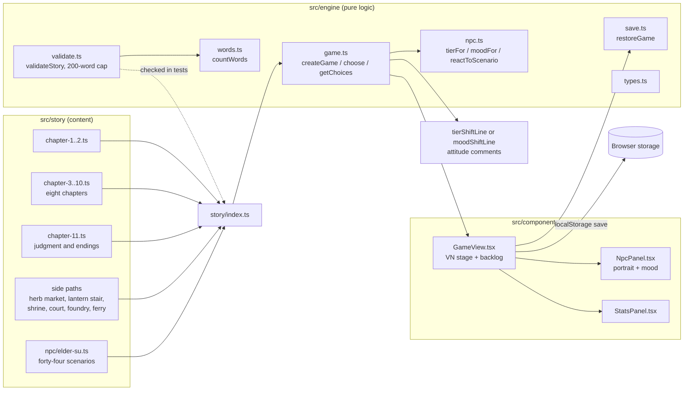

## Turn flow

Every choice goes through the same path. The NPC reacts before the next scene is entered, so her line is the last thing the player reads before the new text.

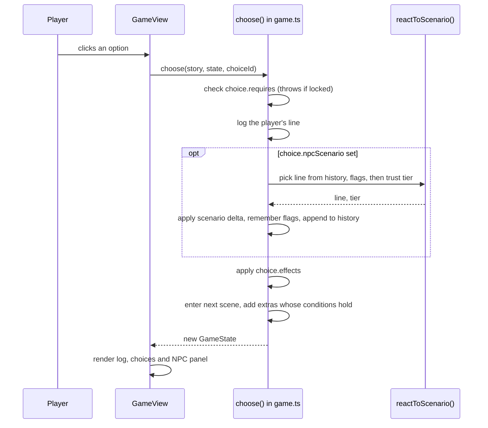

## NPC attitude model

Trust chooses the tier. Memory flags can override the tier line when the NPC remembers something the player did earlier, and the reaction history can override it when she has just heard something from the player (see below).

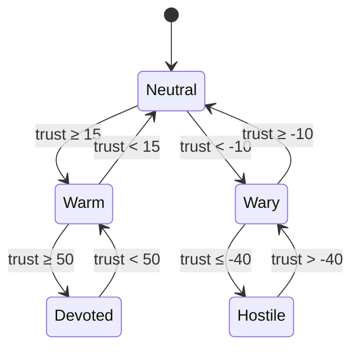

Her face, the mood shown in her portrait, is trust unless fear or suspicion takes over. Fear of 50 or more makes her afraid, and suspicion of 65 or more makes her suspicious. Those two override the tier.

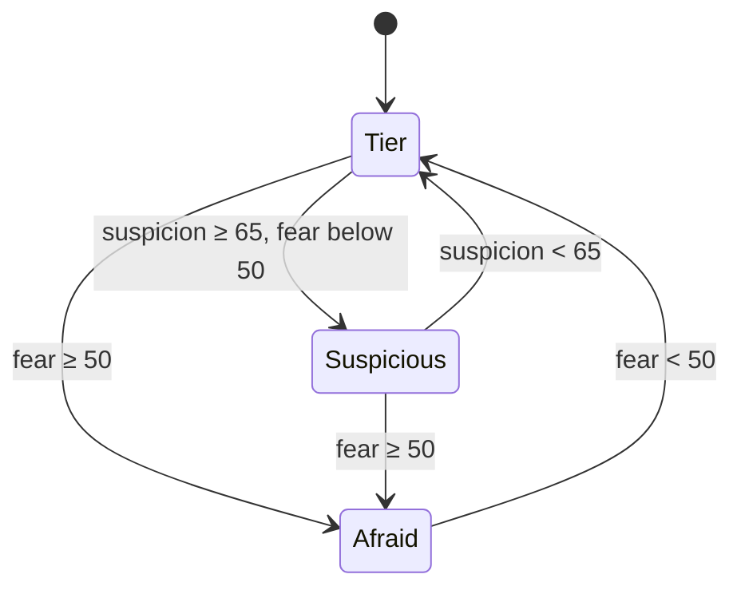

## Attitude shifts and pattern interjections

When a choice crosses a tier boundary, the Elder speaks once more after her reply, so the change is the last thing the player reads. When only her face changes (fear or suspicion takes hold or lets go), she says so instead. Scenes can also carry interjections whose conditions combine flags and her reaction history, so she notices patterns in what the player has done.

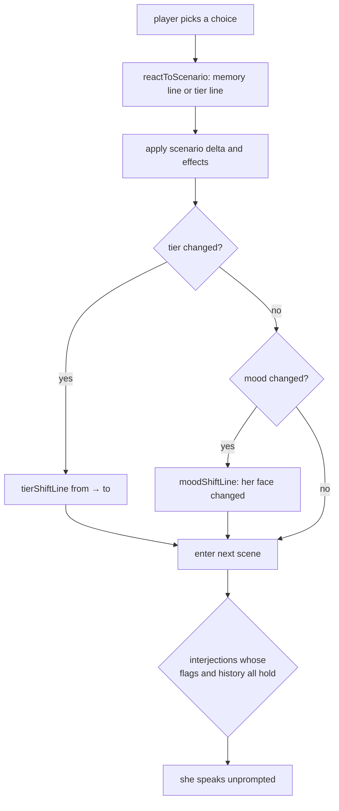

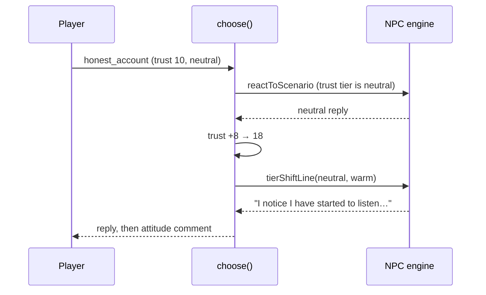

## Reaction memory

Every NPC scenario she reacts to is appended to `history`, in order. A `said` condition reads that list: `min` counts how many times a scenario appears, and `within` looks only at her last N reactions. `within: 1` is "what she just heard". Memory overrides are checked in order, so flag memories written by earlier choices still win over the newer history lines.

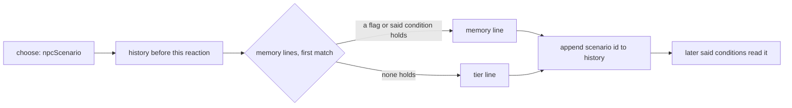

A contradiction is the clearest case. If the player tells the truth and then denies it with nothing else in between, the denial answers differently:

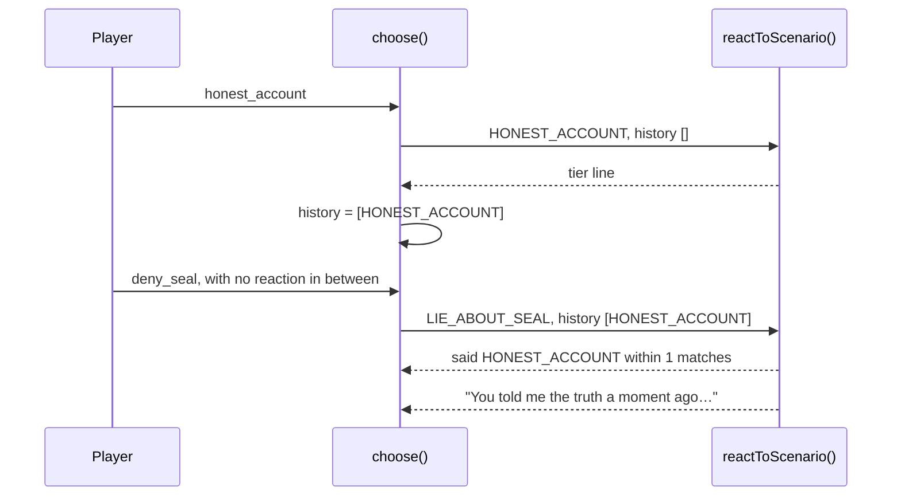

## Body text cap

Every block of body text the player reads at once is capped at 200 words. That covers narration paragraphs, extra paragraphs, NPC interjections, and every NPC line. `validateStory` reports any block over the cap, and the test suite fails until it is split. The count uses `countWords`, the same counter the word-count report uses.

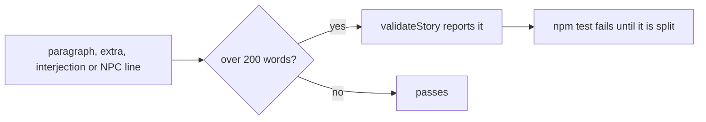

## Chapter map

Reading order is set in `src/story/index.ts`. Each chapter ends by linking into the next one's first scene. The judgment in chapter eleven has five endings, and the Sisters’ Dao ending needs Mengjiao freed on the Sealing Night. Six side paths branch from the main line and rejoin it.

```mermaid
flowchart LR
  C1[1 The Stolen Seal] --> C2[2 The Crimson Abyss]
  C1 -. prepare at the market .-> SM[Side: The Herb Market] -. rejoins at the abyss path .-> C2
  C2 --> C3[3 The Ash Archive]
  C3 -. ask the attendant .-> SS[Side: The Sister’s Shrine] -. rejoins at the sutra door .-> C4
  C3 --> C4[4 The Sutra Door]
  C4 -. follow the lamp keeper .-> SL[Side: The Lantern Stair] -. rejoins at the sutra hall .-> C5
  C4 --> C5[5 The Blood Lotus Sutra]
  C5 --> C6[6 The Jade Eye]
  C6 -. train in the court .-> SC[Side: The Sparring Court] -. rejoins at the summons .-> C7
  C6 --> C7[7 The Tribunal of Bells]
  C7 -. slip behind the dais .-> SF[Side: The Bell Foundry] -. back to the bell rule .-> C7
  C7 --> C8[8 The Second Descent]
  C8 --> C9[9 The Mist Remembers Mengjiao]
  C9 -. take the ferry .-> SW[Side: The Ferry of Still Water] -. rejoins at the hall .-> C10
  C9 --> C10[10 The Sealing Night]
  C10 --> C11[11 The Judgment]
  C11 --> E1[Long Road Down]
  C11 --> E2[Law Remembers Mercy]
  C11 --> E3[Black Lotus Blooms]
  C11 --> E4[Keeper of Bars]
  C11 --> E5[Sisters Dao]
  C10 -. freed Mengjiao .-> C11
```

## Visual novel stage

The stage shows only the current beat. `currentBeat` starts at the player’s latest choice, so the previous scene is hidden. The backlog shows the full log.

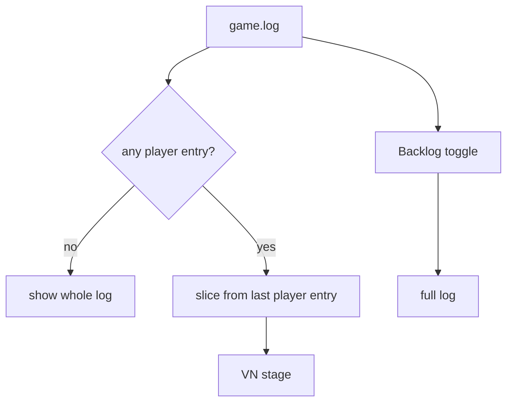

## Saves

A save is the whole `GameState` in `localStorage`, written after every choice. Loading goes through `restoreGame`, which rejects a save that points at a scene the story does not have, and gives a save from before the reaction history an empty `history`, so older progress still loads.

## Scenarios

The Elder reacts to forty-four scenarios. Each has five tier lines. Some have memory overrides, and some of those match on what she has just heard (`said`). Scenes can also carry NPC interjections, which she speaks unprompted when her metrics, flags, or history cross a threshold. Her attitude-shift lines (eight of them) and mood-shift lines (seven, one per mood) sit in `src/engine/npc.ts`.

The table lists the original fifteen. The other twenty-nine are in `src/story/npc/elder-su.ts`. The newest come from the side paths: `REPORT_RUMOR`, `REPORT_SUPPLIES`, `HIDE_MARKET`, `REPORT_LAMP_PASSAGE`, `REPORT_SHRINE`, `SHOW_CASTING_LEDGER`, `REPORT_FERRY`, and `REPORT_BOUT`.

| Scenario | Triggered by | Memory override |
| --- | --- | --- |
| GIFT_HERB | Offering a spirit herb at the gate | — |
| HONEST_ACCOUNT | Telling the truth | `lied_about_seal`; or a third honest account (`said`) |
| LIE_ABOUT_SEAL | Denying the theft | the truth just before (`said` within 1) |
| THREATEN | Threatening the elder | a third threat (`said` min 2) |
| SHOW_MERCY | Sparing Gu Hanzhen | a threat just before (`said` within 1) |
| STEAL_SCROLL | Taking the Heavenly Scroll | — |
| REVEAL_DEMONIC_QI | Using the black lotus | — |
| ASK_FORBIDDEN_ART | Asking about the Blood Lotus Sutra | — |
| INSULT_SECT | Mocking the Law | a repeated insult (`said` min 1) |
| HONOR_ANCESTORS | Kneeling at the tablets | — |
| REFUSE_TASK | Refusing the mission | `stole_scroll` |
| COMPLETE_TASK | Returning the jade | `spared_gu` |
| EXPOSE_HER_SECRET | Revealing Su Mengjiao | — |
| SWEAR_OATH | Swearing a Dao oath | `demonic_glimpsed` |
| ACCEPT_PUNISHMENT | Accepting judgment | `exposed_elder` |
| CHALLENGE_BELL_RULE | Striking the tribunal bell | the casting ledger just shown (`said` within 1) |
| SHOW_CASTING_LEDGER | Showing the names from the casting book | `tore_casting_page` |
| REPORT_FERRY | Telling her what the ferryman charges | `paid_with_name`, `refused_ferry` |
| REPORT_SHRINE | Telling her about the shrine | `lit_shrine`, `took_comb` |
| REPORT_BOUT | Telling her about the sparring court | `used_mist`, `boasted` |

## Quality gates

- `npm test` checks that every decision has at least four choices, that every link resolves, that there are at least ten NPC scenarios, that each scenario produces five distinct replies, that every `said` condition names a real scenario, and that no body text runs over 200 words.
- `npm run word-count` reports player-facing words against the 1,000,000-word goal.
- CI (`.github/workflows/ci.yml`) runs lint, typecheck, tests, word count, and the production build.
