# Architecture

The game is split into a pure story engine and a thin React shell. The engine has no React or DOM dependencies, so every rule is covered by unit tests.

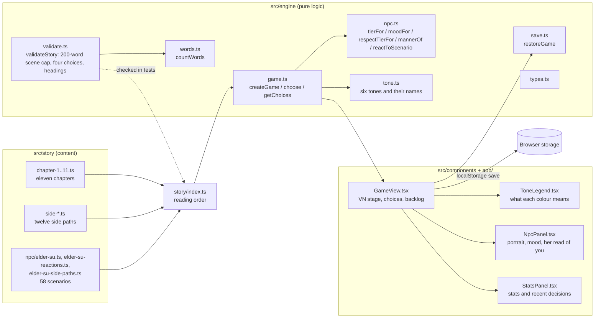

## Turn flow

Every choice goes through the same path. A decision logs the player’s line, records its tone, and lets the Elder react before the next scene is entered, so her line is the last thing the player reads before the new text. There is no other kind of step: a scene that continues from another is reached by a choice like any other.

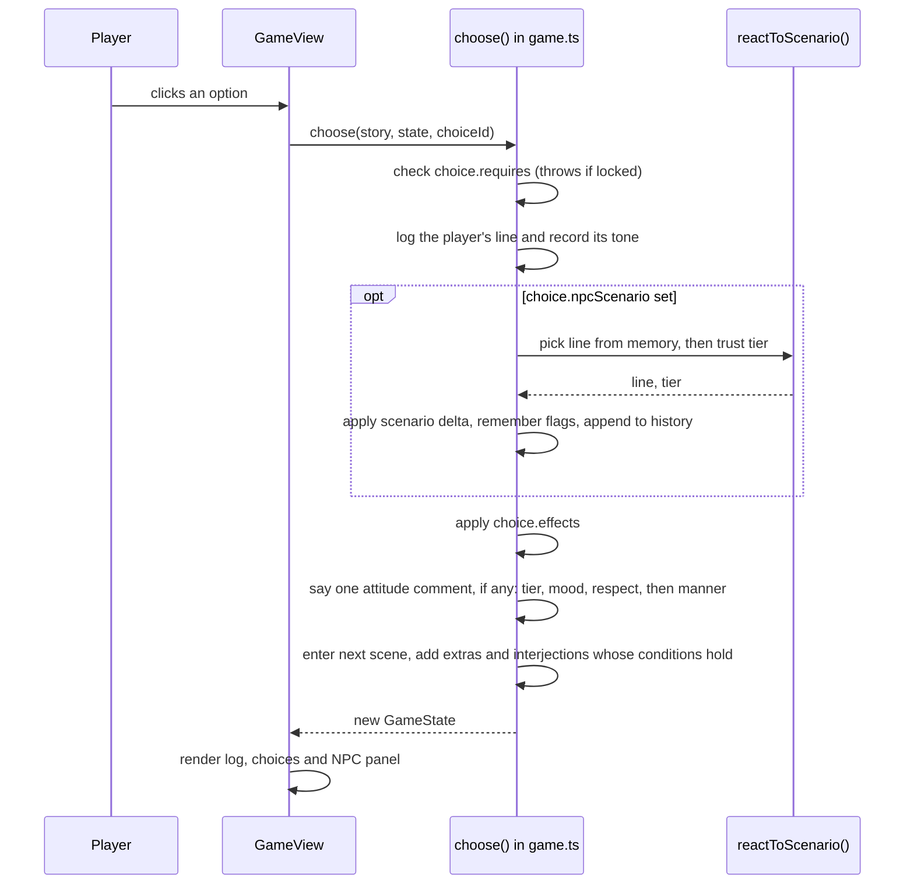

## Choice tones

Every choice has one of six tones. The tone sets the colour of the option, its tag, and its dot in the player’s recent decisions. The Elder keeps count of the tones too, so a pattern of decisions changes what she says.

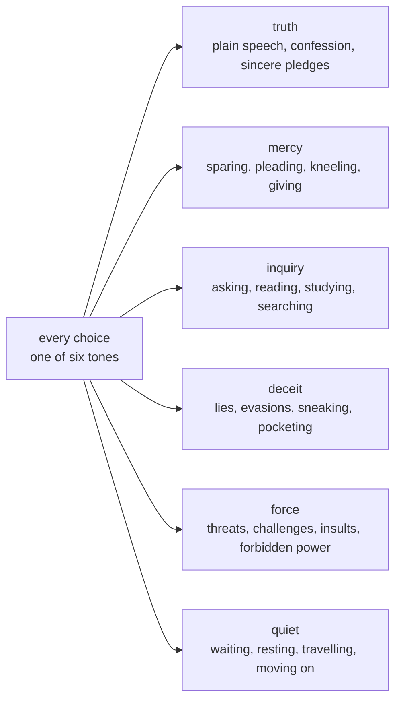

## Scene cap and headings

There are no page turns, Continue buttons or passages. Each scene is one screen: its heading, its narration, any extra paragraphs and interjections whose conditions hold, and its choices. The body text of every scene, counting every extra and every interjection as if it shows, is capped at 200 words. A long stretch of story is written as several scenes, each one ending in choices that lead on. Every scene has a heading of its own.

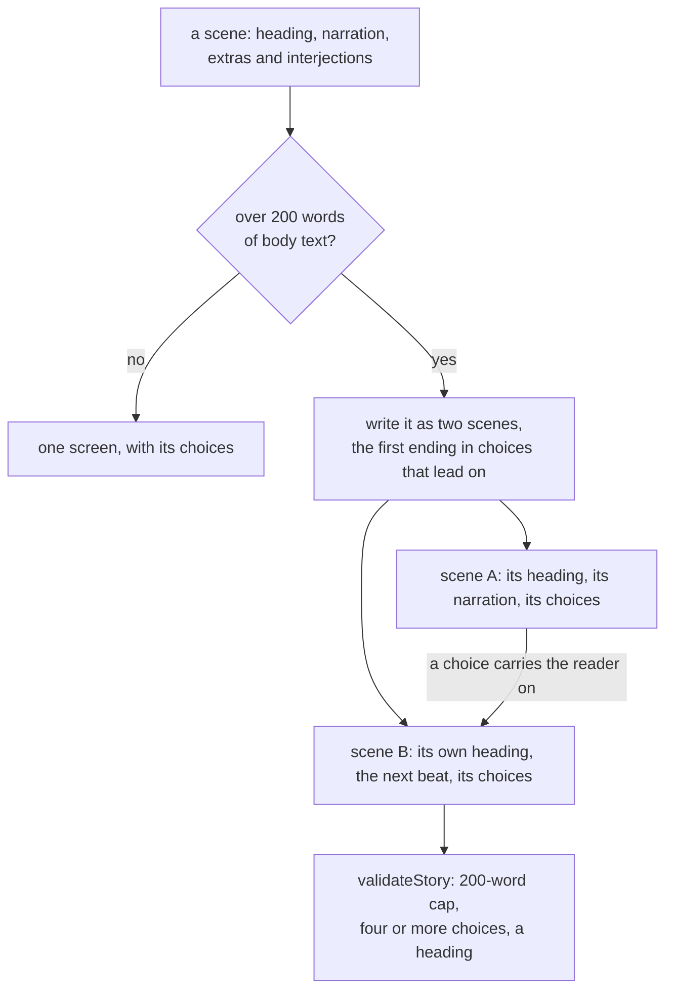

## Side paths

A side path opens from one choice in a main-line scene. That choice sets a `visited` flag and may carry an NPC reaction. Inside, four approaches each run four scenes, and a hidden route from one approach runs two more. Every path ends in a return scene, whose first choice reports to the Elder and whose other choices rejoin the main line. The return scene can also say something unprompted when a flag the path set is present.

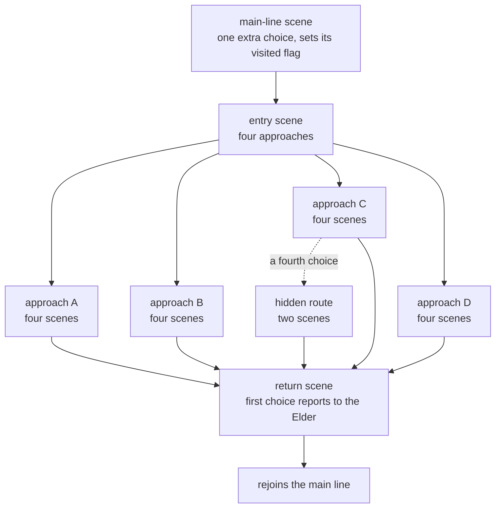

## Chapter and side path map

Reading order is set in `src/story/index.ts`. Chapters are the main line. Side paths branch from a scene and rejoin it, and the Elder reacts to what they report.

```mermaid
flowchart LR
  C1[1 The Stolen Seal] --> C2[2 The Crimson Abyss]
  C1 -. the Elder's mission .-> VL[Side: The Foothill Village] -. back to the abyss .-> C2
  C1 -. prepare at the market .-> HM[Side: The Herb Market]
  HM -. rejoins at the abyss path .-> C2
  HM -. follow the clatter .-> PV[Side: The Pavilion of Stone Wagers] -. back to the market .-> HM
  HM -. follow the bitter smell .-> HL[Side: The Healer’s Hall] -. back to the market .-> HM
  C2 -. climb the eastern peak .-> EP[Side: The Eastern Peak] -. back to the Law Hall .-> C3
  C2 --> C3[3 The Ash Archive]
  C3 -. ask the attendant .-> SS[Side: The Sister’s Shrine] -. rejoins at the sutra door .-> C4
  C3 -. follow the pale vein .-> QR[Side: The Quarry Under the Archive] -. back to the reading room .-> C3
  C3 --> C4[4 The Sutra Door]
  C4 -. follow the lamp keeper .-> SL[Side: The Lantern Stair] -. rejoins at the sutra hall .-> C5
  C4 --> C5[5 The Blood Lotus Sutra]
  C5 --> C6[6 The Jade Eye]
  C6 -. train in the court .-> SC[Side: The Sparring Court] -. rejoins at the summons .-> C7
  C6 -. cross the Cloud Gap .-> CG[Side: The Cloud Gap Bridge] -. back to the tribunal .-> C7
  C6 --> C7[7 The Tribunal of Bells]
  C7 -. slip behind the dais .-> SF[Side: The Bell Foundry] -. back to the bell rule .-> C7
  C7 --> C8[8 The Second Descent]
  C8 --> C9[9 The Mist Remembers Mengjiao]
  C9 -. take the ferry .-> SW[Side: The Ferry of Still Water] -. rejoins at the hall .-> C10
  C9 --> C10[10 The Sealing Night]
  C10 --> C11[11 The Judgment]
  C11 --> E1[Long Road Down]
  C11 --> E2[Law Remembers Mercy]
  C11 --> E3[Black Lotus Blooms]
  C11 --> E4[Keeper of Bars]
  C11 --> E5[Sisters Dao]
  C10 -. freed Mengjiao .-> C11
```

## NPC attitude model

Trust chooses the tier. Memory flags can override the tier line when the NPC remembers something the player did earlier, and the reaction history and recent tones can override it when she has just heard something or the player has been choosing in a pattern (see below).

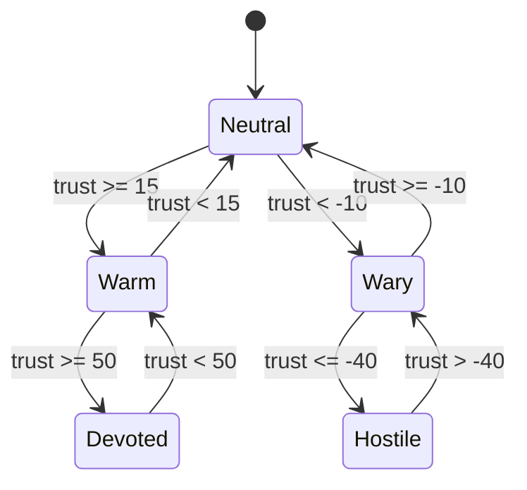

Her face, the mood shown in her portrait, is trust unless fear or suspicion takes over. Fear of 50 or more makes her afraid, and suspicion of 65 or more makes her suspicious. Those two override the tier.

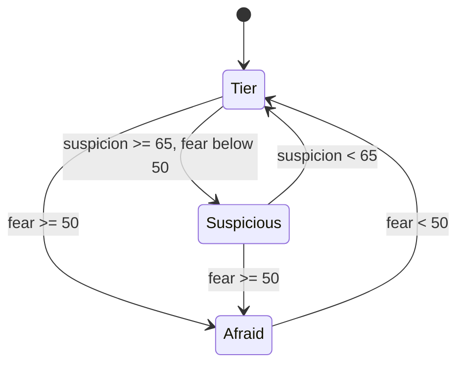

## Respect bands

Respect is earned by what she sees the player do, and some choices gate on it. Its four bands are contempt, unregarded, weighed and respected. Each band has a line, and she says it when respect moves into a new band.

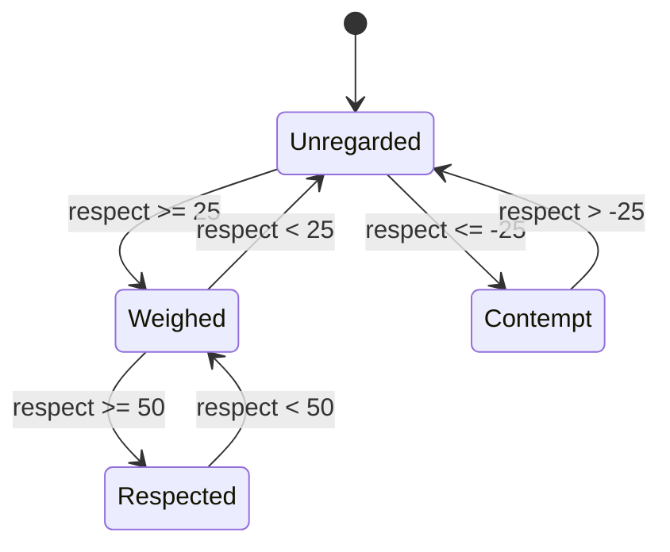

## Attitude shifts, manner and pattern interjections

Only one attitude comment is said per choice, in a fixed order. When a choice moves her to another tier, that comes first. When only her face changes, that comes next. If her respect moves into a new band, she says so. When the player’s recent decisions settle on one tone, she names that manner. After the comment, interjections whose conditions combine flags, her reaction history and the tones of the player’s decisions can speak as the next scene opens.

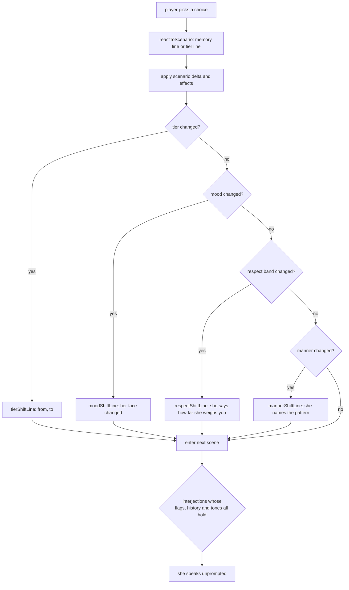

A manner is the tone that makes up at least three of the player’s last four decisions. She names it once, when it first forms, so a steady pattern is not repeated on every choice.

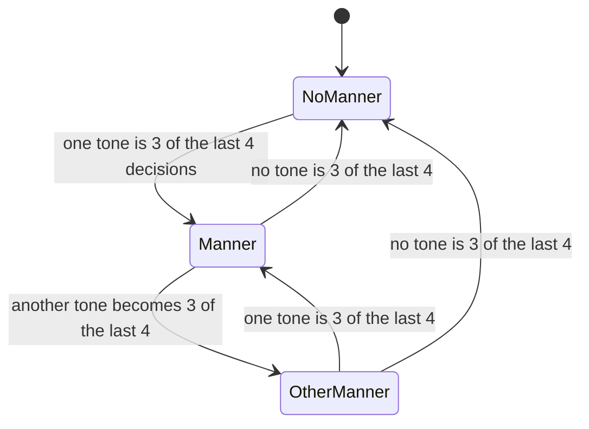

## Reaction memory

Every NPC scenario she reacts to is appended to `history`, in order. A `said` condition reads that list: `min` counts how many times a scenario appears, and `within` looks only at her last N reactions. `within: 1` is “what she just heard”. A `tone` condition reads the same way over the tones of the player’s decisions, so `min: 3, within: 4` is “three of the last four decisions were deceit”. A `flag` condition reads what the player has set, and an `npc` condition reads her metrics, so respect can shape a memory line too. Memory overrides are checked in order, so flag memories written by earlier choices still win over the newer history and tone lines.

Every one of the 58 scenarios has at least one memory override, so her reply to the same choice can differ with the path the player has taken.

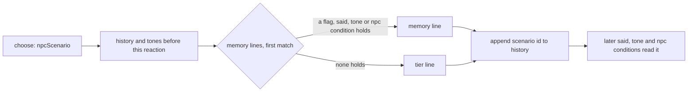

A contradiction is the clearest case. If the player tells the truth and then denies it with nothing else in between, the denial answers differently:

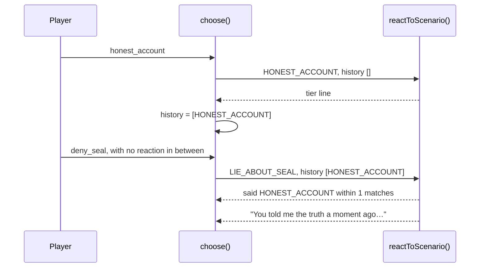

## Length caps

Every scene body is capped at 200 words, and so is every NPC line: each tier line, memory line, interjection and attitude comment. `validateStory` reports any scene or line over its cap, and the test suite fails until it is split or shortened. The count uses `countWords`, the same counter the word-count report uses.

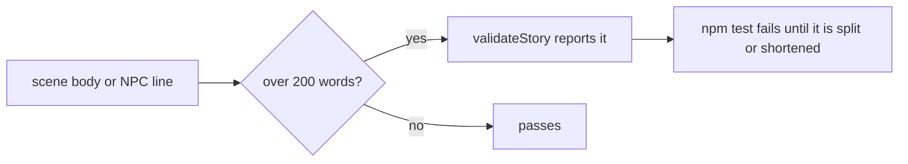

## Visual novel stage

The stage shows only the current beat. `currentBeat` starts at the player’s latest choice, so the previous scene is hidden. The new scene’s heading and text follow the Elder’s reply. The backlog shows the full log.

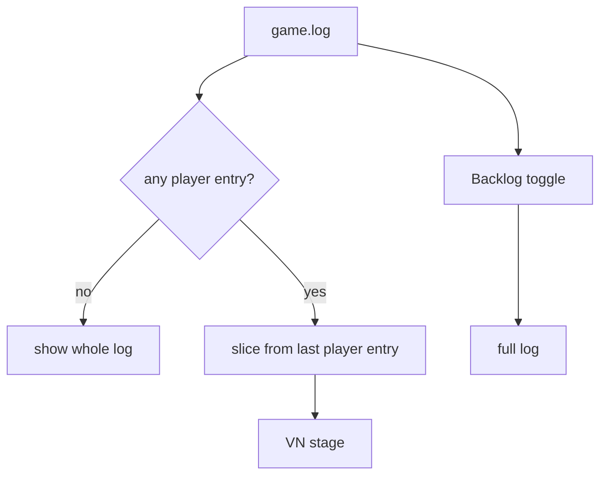

## Saves

A save is the whole `GameState` in `localStorage`, written after every choice. Loading goes through `restoreGame`, which rejects a save that points at a scene the story does not have, and gives a save from before the reaction history or the decision tones an empty `history` or `tones`, so older progress still loads. Scene ids of the earlier page turns are still scenes, so older saves that stood on one still load.

## Scenarios

The Elder reacts to fifty-eight scenarios. Each has five tier lines and at least one memory override. Some of them match on what she has just heard (`said`), on the flags the player has set, on the tones of recent decisions (`tone`), or on her respect (`npc`). Scenes can also carry NPC interjections, which she speaks unprompted when her metrics, flags, history or tones cross a threshold. Her attitude-shift lines (eight of them), respect-shift lines (four), mood-shift lines (seven, one per mood) and manner lines (six, one per tone) sit in `src/engine/npc.ts`.

The scenarios are in `src/story/npc/elder-su.ts`, the reactions added for choices she used to let pass are in `src/story/npc/elder-su-reactions.ts`, and the reactions to the five newest side paths are in `src/story/npc/elder-su-side-paths.ts`. The table lists the scenarios whose memory overrides matter most to a playthrough, and the source has the rest.

| Scenario | Triggered by | Memory override |
| --- | --- | --- |
| GIFT_HERB | Offering a spirit herb at the gate | a run of deceit (`tone` deceit, 2 of the last 3) |
| HONEST_ACCOUNT | Telling the truth | `lied_about_seal`; a third honest account (`said`); a blade in the voice (`tone` force, 2 of the last 3) |
| LIE_ABOUT_SEAL | Denying the theft | the truth just before (`said` within 1); a run of lies (`tone` deceit, 3 of the last 4) |
| THREATEN | Threatening the elder | a third threat (`said` min 2); silence and then a threat (`tone` quiet, 3 of the last 4) |
| SHOW_MERCY | Sparing Gu Hanzhen | a threat just before (`said` within 1); a run of mercy (`tone` mercy, 3 of the last 4) |
| ASK_FORBIDDEN_ART | Asking about the Blood Lotus Sutra | a run of questions (`tone` inquiry, 3 of the last 4) |
| STEAL_SCROLL | Taking the Heavenly Scroll | a theft after kneeling at the tablets (`flag` honored_ancestors) |
| HONOR_ANCESTORS | Kneeling at the tablets | a scroll stolen from the same shelf (`flag` stole_scroll) |
| REFUSE_TASK | Refusing the mission | `stole_scroll` |
| COMPLETE_TASK | Returning the jade | `spared_gu` |
| EXPOSE_HER_SECRET | Revealing Su Mengjiao | the painted name asked about (`said` ASK_TABLET within 5) |
| SWEAR_OATH | Swearing a Dao oath | `demonic_glimpsed` |
| ACCEPT_PUNISHMENT | Accepting judgment | `exposed_elder` |
| CHALLENGE_BELL_RULE | Striking the tribunal bell | the casting ledger just shown (`said` within 1) |
| SHOW_CASTING_LEDGER | Showing the names from the casting book | `tore_casting_page` |
| REPORT_FERRY | Telling her what the ferryman charges | `paid_with_name`, `refused_ferry` |
| REPORT_SHRINE | Telling her about the shrine | `lit_shrine`, `took_comb` |
| REPORT_BOUT | Telling her about the sparring court | `used_mist`, `boasted` |
| REQUEST_NIGHT | Asking for a night before the abyss | a run of waiting (`tone` quiet, 3 of the last 4) |
| OFFER_TO_FETCH_GU | Offering to find Gu alone | `spared_gu` |
| PLEAD_FOR_PARDON | Pleading at the dais | `spared_gu`; a run of lies (`tone` deceit, 2 of the last 4) |
| ACCEPT_EXILE | Accepting exile in silence | a run of force (`tone` force, 2 of the last 4) |
| CLAIM_SEAT | Claiming her seat | `exposed_elder` |
| SEIZE_JADE | Seizing the Sealing Jade | `lied_about_seal` |
| REPORT_WAGER | Reporting the stone tables | `paid_bo_lan`, `broke_tang_table`, `cheated_at_tiles` with `confessed_loaded_tile`, a run of force, a run of mercy |
| REQUEST_VILLAGE | Asking leave to visit the foothill village | a request for a night just before (`said` REQUEST_NIGHT within 3) |
| REPORT_VILLAGE | Reporting the levy from the village | `read_gu_letter`; the second list brought back (`found_hidden_list`, `took_hidden_list`) |
| REPORT_QUARRY | Reporting the cut in the quarry | the second shard found (`quarry_found_heart`); a miner rescued (`quarry_rescued_miner`) |
| REPORT_HEALER | Reporting the calm dust | the Elder’s dose note taken (`took_elders_note`); a page torn from the ledger (`took_dust_page`) |
| ASK_HERMIT | Climbing to the eastern peak | a run of lies (`tone` deceit, 3 of the last 4) |
| REPORT_HERMIT | Reporting the old master’s bargain | the Su sisters told apart (`heard_lu_ming_sisters`); the first page taken (`took_first_page`) |
| REPORT_BRIDGE | Reporting the Cloud Gap bridge | a boy helped and a disciple caught (`bridge_helped_boy`, `bridge_caught_fall`); a token kept (`carries_lu_ping_token`) |

## Quality gates

- `npm test` checks that every decision has at least four choices and a tone, that every scene has a heading, that every link resolves, that there are at least forty NPC scenarios, that each scenario produces one reply per trust tier it can reach, that every `said` and `tone` condition names something real, that no scene body or NPC line runs over its cap, that the respect bands and their lines are distinct, that the side paths open and rejoin, and that the colour legend defines all six tones in both themes.
- `npm run word-count` reports player-facing words against the 1,000,000-word goal, with the largest scene body against its 200-word cap.
- CI (`.github/workflows/ci.yml`) runs lint, typecheck, tests, word count, and the production build.
