# Architecture

The game is split into a pure story engine and a thin React shell. The engine has no React or DOM dependencies, so every rule is covered by unit tests.

```mermaid
flowchart LR
  subgraph Story["src/story (content)"]
    C["chapter-1..11.ts<br/>eleven chapters"]
    SD["side-*.ts<br/>twelve side paths"]
    RD["roads/<br/>forty Book One side roads, 1,010 scenes"]
    R2["roads2/<br/>forty realm roads, 1,020 scenes"]
    FR["fortune/<br/>forty Fortune Roads, 1,020 scenes,<br/>each pricing its goods, wages and lease"]
    WR["witness/<br/>forty Witness Roads, 1,020 scenes,<br/>four deeds the Elder answers at once"]
    CR["cultivation/<br/>forty Cultivation Roads, 1,020 scenes,<br/>four practices the Elder answers at once"]
    XR["crossing/<br/>forty Crossing Roads, 1,380 scenes:<br/>gender, root and craft doors, attunement"]
    AR["age/<br/>forty Age Roads, 1,136 scenes:<br/>five ages meet eight realms, a door of years,<br/>seven turning points, endings that read the years"]
    CS["custom/<br/>forty Custom Roads, 1,490 scenes:<br/>ten customs, four keepers, a door for a woman,<br/>a man or no answer, seven gender turning points"]
    RK["rank/<br/>thirty-two Rank Roads, 1,200 scenes:<br/>eight rungs, four keepers who read rank or sex first,<br/>a door of rank by gender and by where the realm stands,<br/>eight realm-and-gender turning points"]
    TB["tribulation/<br/>eight Tribulation Roads, 1,008 scenes:<br/>four keepers who bow by the realm, a rehearsal of the trial,<br/>echoes where the world bows to the realm"]
    WD["wardrobe/<br/>eight Wardrobe Roads, 1,008 scenes:<br/>four keepers who read the dress, a six-scene fitting<br/>(counter, rack, verdict, commission, hatch, mirror),<br/>echoes, endings and the Elder’s remarks on a change of dress"]
    GD["gendered/<br/>Left Cloister, Right Yard, Third Door"]
    OG["origins/<br/>twelve beginnings, eleven prologues"]
    EC["economy/<br/>five reckonings, seven ending epilogues,<br/>remarks on the purse and the pack"]
    HE["hero/<br/>Elder’s asides, gate echoes, companion remarks"]
    RG["realm-gates.ts<br/>force asks a realm in Book One"]
    NPC["npc/elder-su*.ts<br/>98 scenarios, realm memories"]
  end
  subgraph Engine["src/engine (pure logic)"]
    G["game.ts<br/>createGame / choose / getChoices"]
    N["npc.ts<br/>tierFor / moodFor / respectTierFor / mannerOf / reactToScenario"]
    TN["tone.ts<br/>six tones and their names"]
    CU["cultivation.ts<br/>eight realms, gains, heart demon"]
    EO["economy.ts<br/>purse, pack, holdings, speed,<br/>payday, breakthrough pills"]
    HR["hero.ts<br/>the character, pronouns, starting numbers, standing"]
    AG["age.ts<br/>years, lifespan by realm, waning,<br/>the door of years"]
    V["validate.ts<br/>validateStory: 200-word scene cap, four choices, headings"]
    SV["save.ts<br/>restoreGame"]
    W["words.ts<br/>countWords"]
    T["types.ts"]
    WI["witness.ts<br/>deeds, repute bands, counts"]
    PR["practice.ts<br/>four practices, the cusp, counts"]
    CUS["custom.ts<br/>customSummary: kept, bent, broken, stood for"]
    TRE["tribulation.ts<br/>eight tribulations, the bow by realm,<br/>trial needs, the sky’s line at a breakthrough"]
    WE["wardrobe.ts<br/>five garments, wear, gain, lose, price, pawn,<br/>what a dress pays and costs on a payday"]
    PK["pack.ts<br/>use, sell and give an item,<br/>dress changes from the panel"]
    RKE["rank.ts<br/>bandOf, bandsAt, rankSummary:<br/>yielded, claimed, veiled, lifted"]
  end
  subgraph UI["src/components + app/"]
    CR["Creation.tsx<br/>who climbs the mountain"]
    HP["HeroPanel.tsx<br/>name, traits, standing"]
    GV["GameView.tsx<br/>VN stage, choices, backlog"]
    TL["ToneLegend.tsx<br/>what each colour means"]
    NP["NpcPanel.tsx<br/>portrait, mood, her read of you"]
    SP["StatsPanel.tsx<br/>stats and recent decisions"]
    CP["CultivationPanel.tsx<br/>realm, progress, ladder"]
    XP["CrossingPanel.tsx<br/>elements attuned, doors taken"]
    AP["AgePanel.tsx<br/>years against the span of the realm"]
    PP["PursePanel.tsx<br/>stones, speed by part, pack, holdings"]
    CUP["CustomPanel.tsx<br/>the tally of the doors of custom"]
    TRP["TribulationPanel.tsx<br/>the eight trials, how the sect bows"]
    WP["WardrobePanel.tsx<br/>the dress worn, the dresses owned, Wear"]
    RKP["RankPanel.tsx<br/>rank roads at each rung, the ways taken"]
  end
  C & SD & RD & R2 & FR & WR & CR & XR & AR & CS & RK & TB & WD & GD & OG & EC & HE & RG & NPC --> S["story/index.ts<br/>reading order"]
  S --> G
  G --> HR
  G --> AG
  EO --> AG
  HR --> AG
  N --> WI
  WR --> WI
  CR --> PR
  CS --> CUS
  CUS --> CUP
  RK --> RKE
  TB --> TRE
  WD --> WE
  WE --> HR
  WE --> EO
  G --> WE
  PK --> G
  PK --> WE
  PK --> EO
  PK --> WP
  TRE --> CU
  TRE --> TRP
  RKE --> RKP
  G --> N
  G --> TN
  G --> CU
  G --> EO
  EO --> CU
  V -. checked in tests .-> S
  V --> W
  G --> GV
  GV --> TL
  GV --> SV
  GV --> CR
  CR -->|Hero| G
  GV --> NP & SP & CP & HP & PP & XP & AP & CUP & RKP & TRP & WP
  GV -->|localStorage save| Storage[("Browser storage")]
```

## Turn flow

Every choice goes through the same path. A decision logs the player’s line, records its tone, earns cultivation, and lets the Elder react before the next scene is entered, so her line is the last thing the player reads before the new text. There is no other kind of step: a scene that continues from another is reached by a choice like any other.

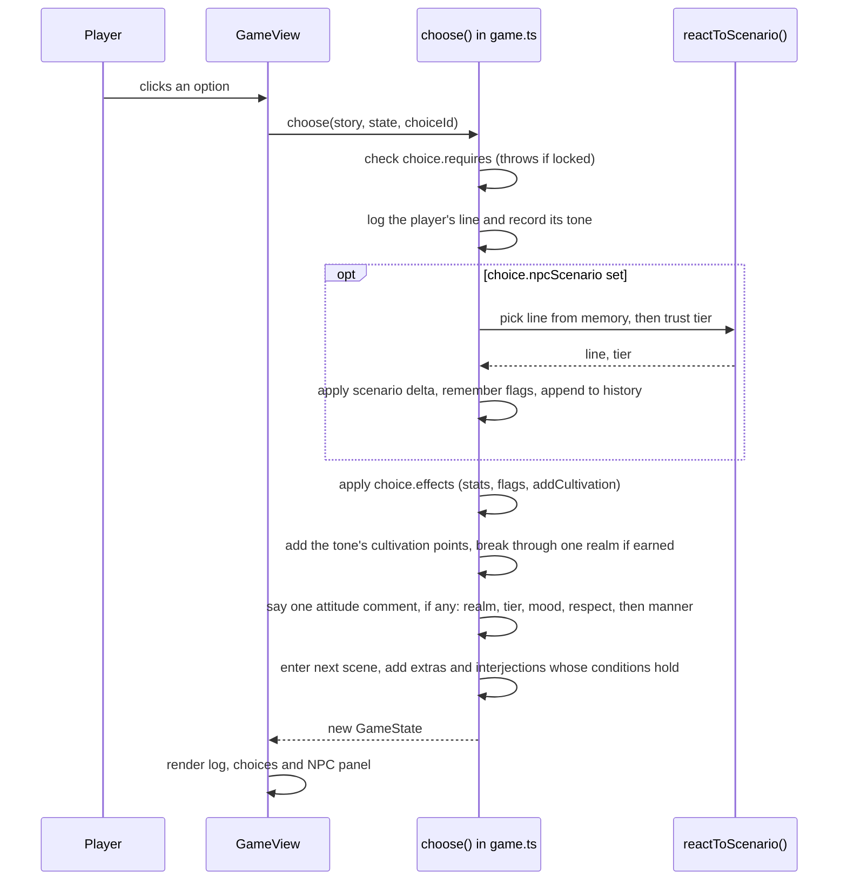

## Choice tones

Every choice has one of six tones. The tone sets the colour of the option, its tag, and its dot in the player’s recent decisions. The Elder keeps count of the tones too, so a pattern of decisions changes what she says.

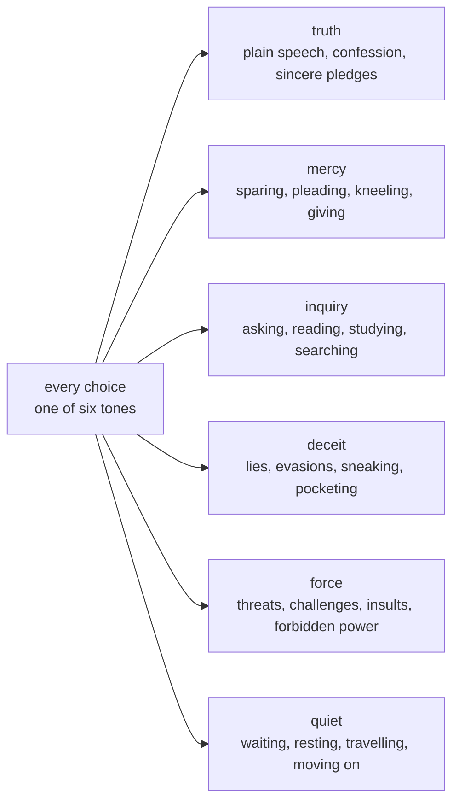

## Scene cap and headings

There are no page turns, Continue buttons or passages. Each scene is one screen: its heading, its narration, any extra paragraphs and interjections whose conditions hold, and its choices. The body text of every scene, counting every extra and every interjection as if it shows, is capped at 200 words. A long stretch of story is written as several scenes, each one ending in choices that lead on. Every scene has a heading of its own.

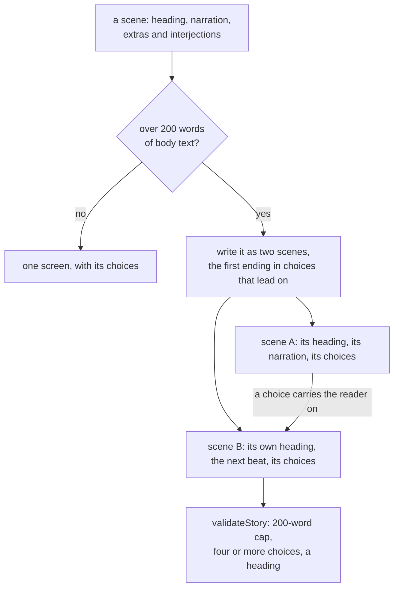

## Side paths

A side path opens from one choice in a main-line scene. That choice sets a `visited` flag and may carry an NPC reaction. Inside, four approaches each run four scenes, and a hidden route from one approach runs two more. Every path ends in a return scene, whose first choice reports to the Elder and whose other choices rejoin the main line. The return scene can also say something unprompted when a flag the path set is present.

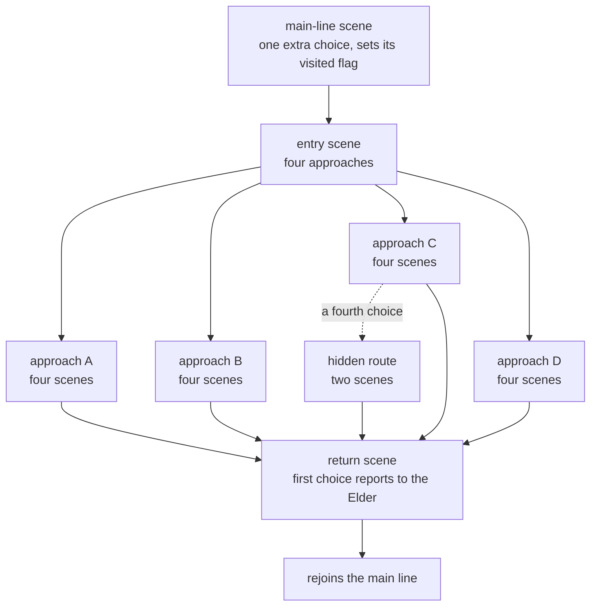

## Cultivation

Every player begins as a Mortal. Each decision earns points by its tone, and an `addCultivation` effect adds more at key moments (the cultivator’s way at a road’s crisis, resting at a road’s end, the hidden route). When the points reach the next realm’s threshold the player breaks through, one realm per decision at most. The breakthrough is its own log entry, shown in gold, and the Elder remarks on it.

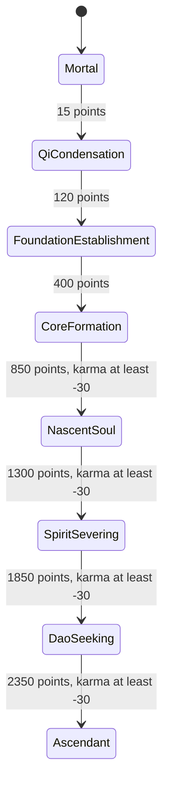

From Core Formation upward a heart demon blocks the next realm while karma is below −30. Points keep gathering, and the breakthrough happens on the first decision after karma recovers.

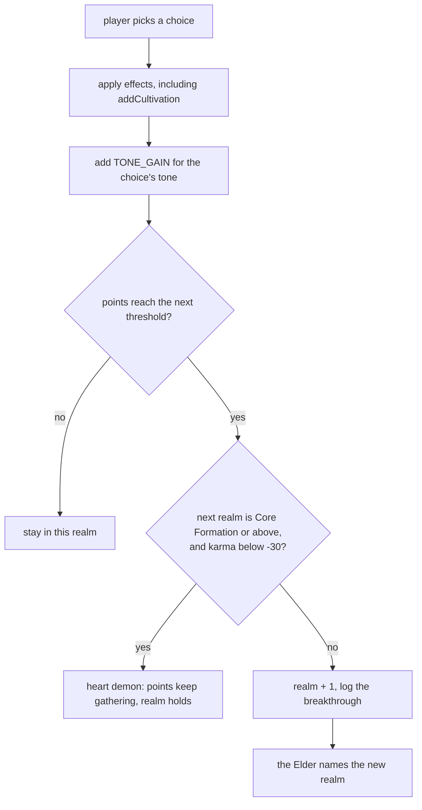

### Why the realm matters: gates, strain, mastery, meditation

The ladder is paced across six books, so a realm is something the story asks for, not a number that saturates in Book One. A diligent player reaches Foundation Establishment by the end of Book I, Core Formation in Book II, Nascent Soul by the end of Book III, Spirit Severing in Book IV and Dao Seeking in Book V. Ascendant is for completionists. `scripts/simulate.ts` (`npm run simulate -- 40 diligent`) random-walks the story under four policies and reports the realm at each book gate and the ending reached.

Three mechanics make the realm bite.

- **Hard gates.** A choice can require `realm>=N`. The requirement stays visible, locked, and tells the player which realm it wants. Book VI's bridge, archive, abyss and final choice all have gated routes.
- **Strain.** A choice can carry `needs:N` (a realm index). Take it below that realm and the attempt costs 10 cultivation per missing realm (never below the current realm's threshold), 12 qi, 3 of the Elder's respect, and logs a strain line. The choice shows a "beyond you" tag in advance. Take it far above the ask (two realms or more) and it grants mastery: +3 cultivation.
- **Meditation.** Every hub has a one-time `still_<hub>` night of stillness that gives a lump of cultivation, so a player who takes their time can be ready for the next gate.

Walking back into a scene already seen gives no tone gain, so shuttling between two hubs cannot farm cultivation.

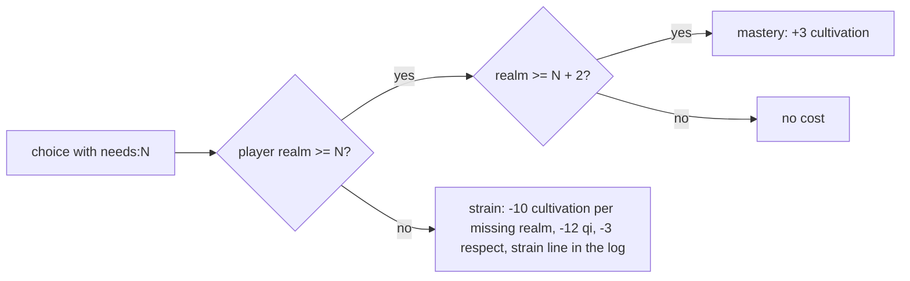

### The endings

Book VI ends at `lastseal_choice`. Each of seven endings has its own gate, and the cheapest is always open, so the story never soft-locks.

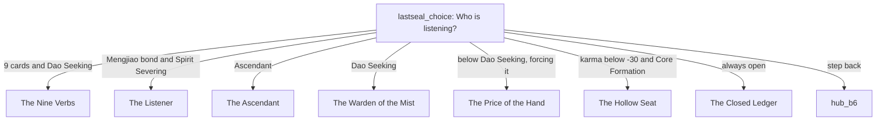

| Tone | Points per decision |
| --- | --- |
| quiet, inquiry, truth, mercy | 2 |
| force, deceit | 1 |

The realm also gates content and reactions. A `realm` condition reads it for choices, extras, interjections and NPC memory lines. The Elder remarks on a mortal at the Law Hall and the abyss, and on a cultivator at the archive, the tribunal and the judgment. Her memory lines for twelve scenarios (a confession, a lie, a threat and so on) change once the player has reached Foundation Establishment, though a flag the player set still wins.

## Talent, Dao and origin

`src/engine/path.ts` holds the rules; `hero.ts` holds the options. Every rule is a pure function of the hero, so the engine stays testable.

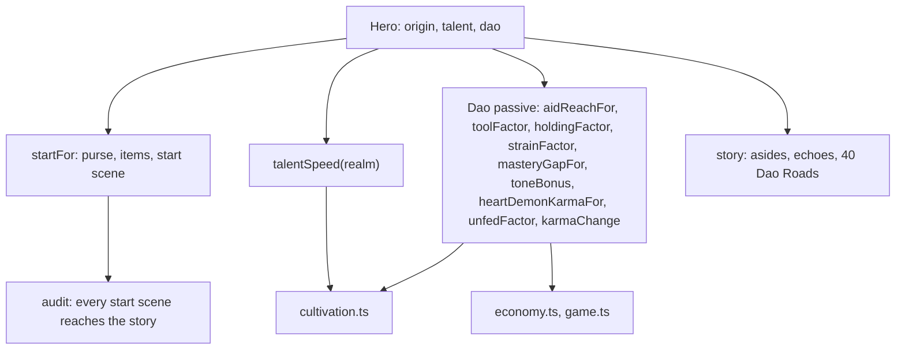

## Side roads

Ten waysides branch off the main line, one from the first scene of each chapter from the gate to the sealing night. That scene gains one choice, and the wayside returns to it. Each wayside offers four roads, and each road is 25 scenes built by `buildRoad` from a short spec (place, keeper, relic, omen, secret, four things to approach) and the shared wording in `lexicon.ts`. 40 roads × 25 scenes plus 10 waysides is 1,010 scenes.

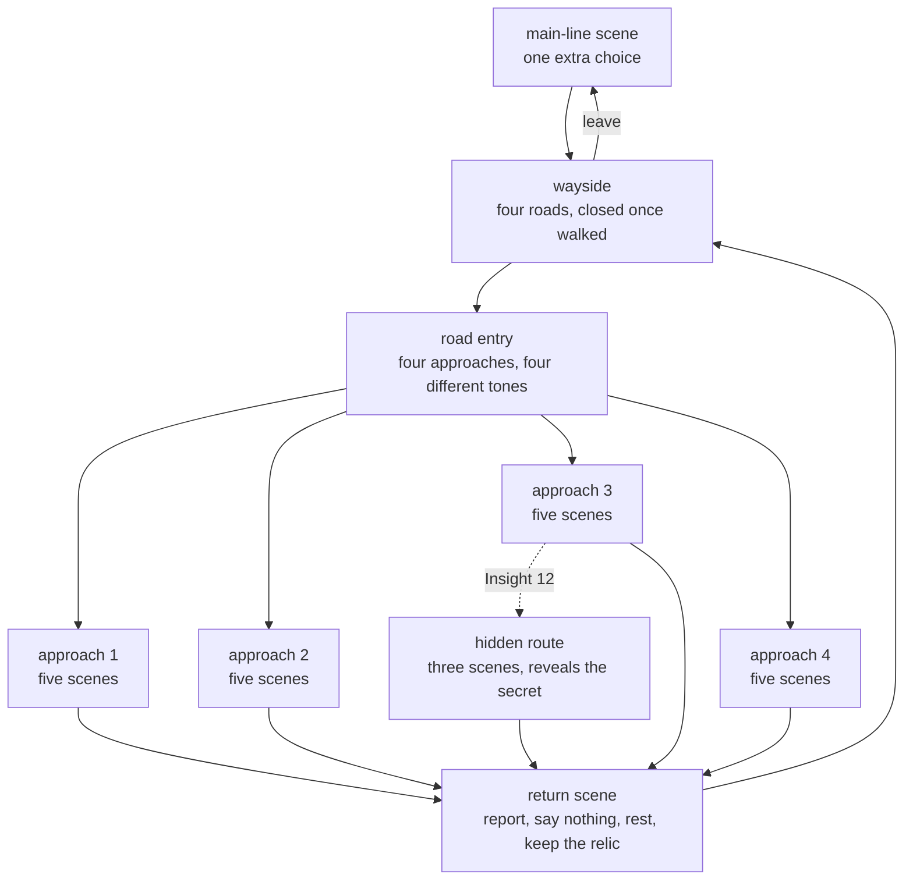

Each approach scene has four choices in four different tones. The fourth scene of each approach, the crisis, also offers the cultivator’s way, which needs a realm that rises with the wayside (Qi Condensation for the first three, Foundation Establishment for the next four, Core Formation for the last three).

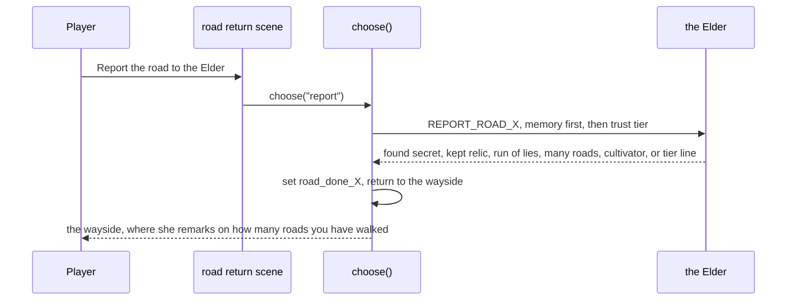

The `roads` condition counts the `road_done_*` flags, so the Elder can speak to the number of roads walked. Because every interjection counts toward a scene’s 200-word cap whether or not it shows, those remarks live on the waysides, one each, instead of on the return scenes.

## The hero

Before the first scene the player makes a character: a name, and five parts that any NPC can see at a glance (papers, dress, looks, trade since the river village, gender). `createGame(story, hero)` stores it in `GameState.hero`, and it never changes. Nothing about the hero changes what the player can do. Cultivation does that. It changes how people answer.

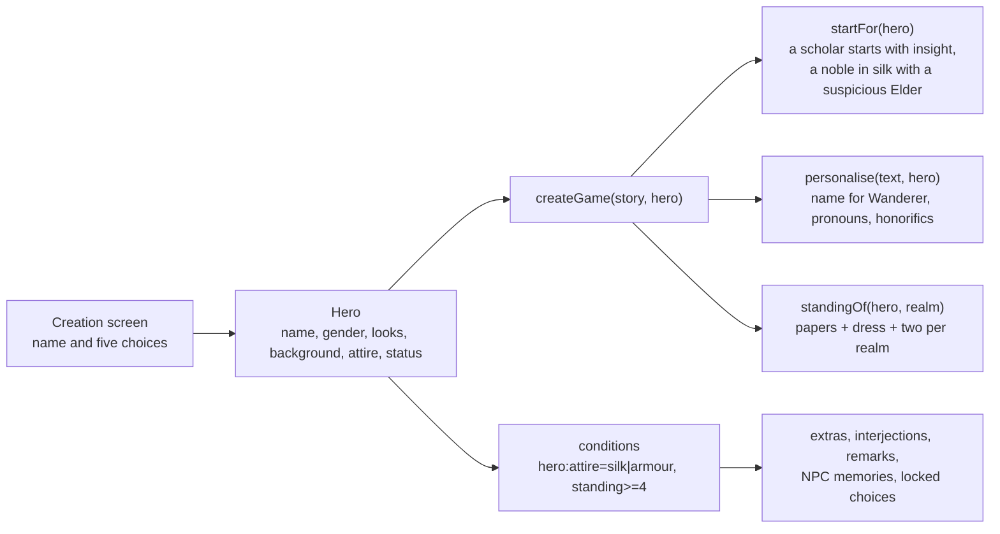

Every line the engine logs goes through `personalise`, so a hero called Mo Lan is never called Wanderer, and `{they}`, `{them}`, `{their}`, `{honorific}` and `{person}` fill in from the gender. A save from before the hero existed loads with the default hero.

### Standing

Standing is how far the world bows, and the realm outweighs birth. The papers set a rank from 0 (outcast) to 3 (noble), silk or armour adds one, rags take one away, and **every realm adds two**. A Foundation Builder born an outcast already stands above a mortal prince.

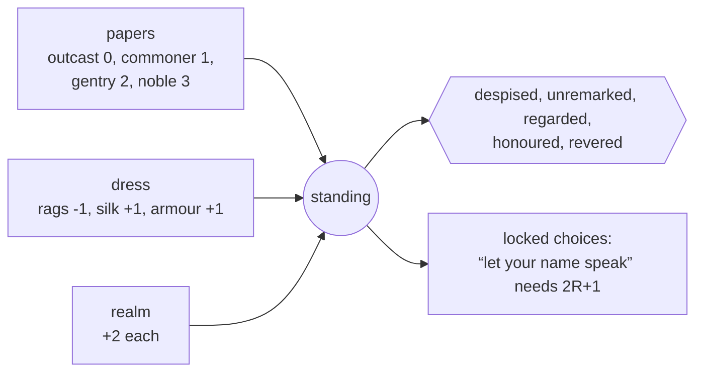

### How the cast reads the hero

Four layers, so a hero meets a reaction wherever the story is, and none of them is the same line for two heroes.

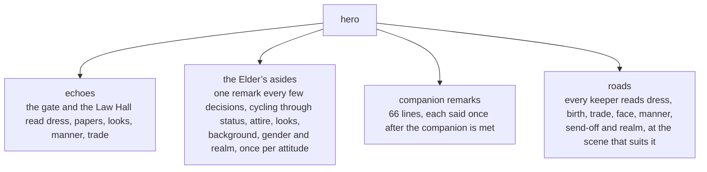

`story.asides` holds 22 values × 5 attitudes of her lines about the hero and 4 realm bands × 5 attitudes. `aside()` in `game.ts` says one after her reply to a scenario, after the fourth decision and at most once every three decisions, in a rotating order. The id of each (`aside:field:value:tier`) is kept in `remarked`, so it is never said twice, and a colder or warmer Elder has something new to say about the same silk.

## Realm roads

Ten more waysides open from the hubs of Books Two to Six, each with four roads of 25 scenes. Where the Book One roads are built from shared templates, each realm road writes its own twenty situations, its three hidden scenes and its closing paragraph (`specs-*.ts`). The builder adds the choices, tones, realm gates and reactions.

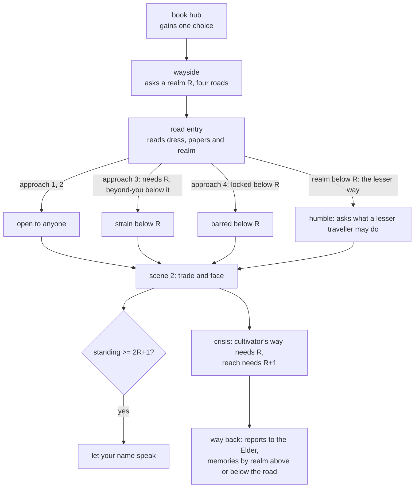

The realm bands the keepers use are *relative* to the road: far below (two or more realms short), below (one short), at it, above it. A keeper greets each differently at the entry, the first scene, the crisis and the way back. At the crisis a hero below the road’s realm pays for a push: cultivation, qi and the Elder’s respect, per realm short. Two realms above it, the same choice earns mastery.

### Wording that fits

A road names four things to approach, and shared wording says what to do with them. Before kinds, “Break your way into the orchard ledger” and “Slip a small piece of the weighing hut into your sleeve” were both possible. Now every focus is a place, a thing or a person (`kinds.ts`), and every template is tagged with the kinds it fits (`[p]`, `[t]`, `[w]`, or combinations). A road is only given wording that fits, and the obstacle and the ally in a label come from the pools of that label’s own tone, so nothing says “Trace a sick child on the step back to whoever put it there”.

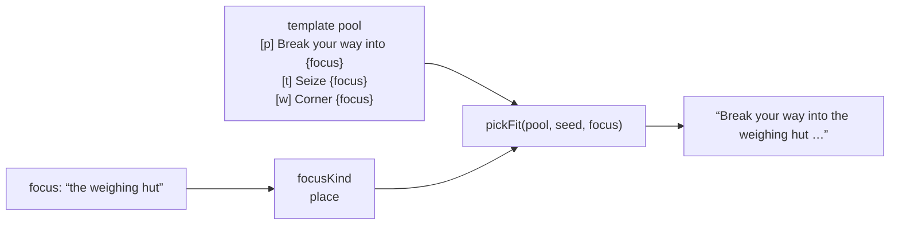

`npx tsx scripts/audit-slots.ts` replays the old selection and counts the picks that did not fit: 686 of the Book One roads’ lines.

### Realm in Book One

The first eleven chapters used to ask nothing of the realm. From the third chapter on every forceful choice now asks the realm of its chapter (`realm-gates.ts`): Qi Condensation in Chapters 3 and 4, Foundation Establishment from 5 to 11. A player below it can try, and pays; a player two realms above it does the same thing with ease and learns from it. A player who forces every door can reach Book Two still at Qi Condensation, where a patient one is a Foundation Builder.

## Wealth, pack, holdings and speed

Cultivation is no longer the only thing the hero carries. The purse (spirit stones), the pack (items by id), the holdings (assets by id) and the cultivation speed are all part of `GameState`, all saved, and all readable by the story as conditions (`wealth`, `item`, `asset`, `holdings`, `speed`, `unfed`) and writable as effects (`addWealth`, `giveItem`, `takeItem`, `grantAsset`, `loseAsset`). `src/engine/economy.ts` holds the rules, and `Story.items`, `Story.assets` and `Story.leavesSect` hold the data.

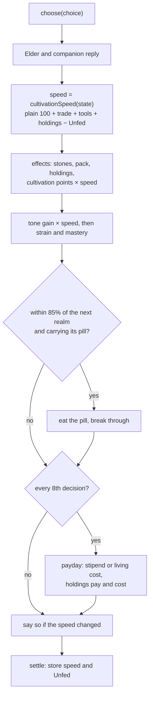

### The numbers

| Part | Rule |
| --- | --- |
| Starting purse | papers (outcast 3, commoner 8, gentry 24, noble 60) plus trade (trader’s runner +12, herbalist and levy deserter +4, paddy hand +3, copyist +2, orphan 0) |
| Payday | every 8 decisions |
| Stipend | on the mountain, until the hero has seen `departure_dawn`: 1 + the realm, per payday |
| Cost of living | after that: 0, 0, 1, 1, 2, 2, 3, 3 stones by realm. A hero whose purse is below it is **Unfed** |
| Speed | 100 + trade aptitude (copyist +5, orphan +3, herbalist +2) + each carried tool, relic, scripture, material or token that has reached its realm + each holding that has reached its realm − 20 if Unfed. Held between 50 and 250. It scales every cultivation point a choice earns |
| Breakthrough pill | eaten when the hero’s points reach 85% of the next realm, if they carry a pill made for that realm and no heart demon holds them back |
| Holding | pays its income and costs its upkeep on each payday. If the purse cannot meet the upkeep, the holding is taken back |
| Price tag | a choice that moves stones shows “Costs N” or “Earns N” before it is picked |

Nothing is a lock. A hero with no purse, no pack and no holding cultivates at the plain rate, or at four fifths of it once they are Unfed. What the economy buys is speed, and a pill is a door held open for a hero who was already reaching.

### What the validator asks

`validateEconomy` (in `validate.ts`) fails the build when a choice spends without requiring the money, hands over an item it does not require the hero to carry, takes on a holding it does not require the hero to lack (or gives one up it does not require them to hold), names an item or an asset that does not exist, moves more than 400 stones, or defines a holding that costs more than it pays. A test also fails if any choice that earns stones can be repeated.

## Fortune roads

Ten more waysides, one at each of ten places the main line stops: the foot of the gate stair, the almonry below the Law Hall, the merit exchange by the sutra door, the night market on the bell steps, the departure sale on the last night, the clerks’ bazaar under the Assembly dome, the Tidewall quays, the caravan ground at the edge of the grass, the salvage yards on the glass shore, and the fair at the foot of the mountain. Each has four roads of 25 scenes, and every road writes its own twenty situations, three hidden scenes and closing paragraph (`fortune/specs-*.ts`).

A road is priced by its realm *R* (1 to 6) and its place in the wayside: a base price of 6 + 4*R* + slot, a wage of 3 + 2*R*, and a lease at four times the base. Each road sells one good (a pill, a tool, a relic, a scripture, a material or a token) and leases one holding. Exactly one road in each wayside sells a pill for the realm after the road’s.

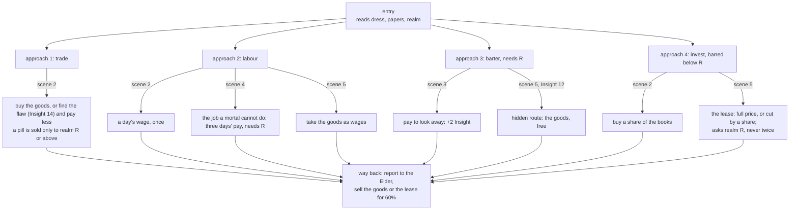

At the crisis of every approach the hero can also settle a debt for half the base price, show the goods they carry, draw on their cultivation (needs *R*) or reach past it (needs *R*+1, and costs cultivation, qi and the Elder’s respect below that). The Elder’s report reads the purse, the pack, the lease, the lies and the realm.

### One walk, no repeats

The roads are built from shared wording, and a walk of one (an entry, five scenes of an approach or three of the hidden route, and the way back) must not read the same menu line or paragraph twice. Each pool a builder draws from holds at least eight lines for each kind of thing a road can name, and the picker steps by *stage*, so no two scenes of a walk share a line. `tests/fortune.test.ts` walks every approach and hidden route of all 120 roads and fails on a repeat. On `main` the Book One roads repeated 858 menu lines and 144 paragraphs, and the realm roads 676 menu lines.

## Accounts on the road

Five short scenes (`economy/reckonings.ts`) sit in front of the river steps and the gates of Books Three to Six, and every way into those scenes now comes through them. The company takes stock. The Elder reads the hero’s realm against what the road expects (two, three, four, five and six: a diligent hero stands there at that point), and says so if they are behind, level or ahead. She notes if the hero is Unfed, or quick. The hero can go through the accounts (+1 Insight), sit the night (cultivation scaled by speed), buy two goods for the road, put ten stones in the common box, or say nothing. Each of the seven endings also closes on the purse and the holdings, in one line.

Three wards in Book Six read an item as a realm: the Returner’s Seven-Star Charm lets a Nascent Soul across the Ash Bridge, the Retired Office Seal lets one through the Archive’s ring, and the First-Plate Shard lets a Spirit Severing cultivator read the abyss doors. Each is used up by the choice that spends it, and each is bought on a Fortune Road.

## Chapter and side path map

Reading order is set in `src/story/index.ts`. Chapters are the main line. Side paths branch from a scene and rejoin it, and the Elder reacts to what they report. The ten wayside groups of Book One side roads follow their chapters, the ten groups of realm roads follow the hubs of Books Two to Six, and the ten groups of Fortune Roads follow the scenes they open from. All three, and the five reckonings, are omitted from the map below.

```mermaid
flowchart LR
  C1[1 The Stolen Seal] --> C2[2 The Crimson Abyss]
  C1 -. the Elder's mission .-> VL[Side: The Foothill Village] -. back to the abyss .-> C2
  C1 -. prepare at the market .-> HM[Side: The Herb Market]
  HM -. rejoins at the abyss path .-> C2
  HM -. follow the clatter .-> PV[Side: The Pavilion of Stone Wagers] -. back to the market .-> HM
  HM -. follow the bitter smell .-> HL[Side: The Healer’s Hall] -. back to the market .-> HM
  C2 -. climb the eastern peak .-> EP[Side: The Eastern Peak] -. back to the Law Hall .-> C3
  C2 --> C3[3 The Ash Archive]
  C3 -. ask the attendant .-> SS[Side: The Sister’s Shrine] -. rejoins at the sutra door .-> C4
  C3 -. follow the pale vein .-> QR[Side: The Quarry Under the Archive] -. back to the reading room .-> C3
  C3 --> C4[4 The Sutra Door]
  C4 -. follow the lamp keeper .-> SL[Side: The Lantern Stair] -. rejoins at the sutra hall .-> C5
  C4 --> C5[5 The Blood Lotus Sutra]
  C5 --> C6[6 The Jade Eye]
  C6 -. train in the court .-> SC[Side: The Sparring Court] -. rejoins at the summons .-> C7
  C6 -. cross the Cloud Gap .-> CG[Side: The Cloud Gap Bridge] -. back to the tribunal .-> C7
  C6 --> C7[7 The Tribunal of Bells]
  C7 -. slip behind the dais .-> SF[Side: The Bell Foundry] -. back to the bell rule .-> C7
  C7 --> C8[8 The Second Descent]
  C8 --> C9[9 The Mist Remembers Mengjiao]
  C9 -. take the ferry .-> SW[Side: The Ferry of Still Water] -. rejoins at the hall .-> C10
  C9 --> C10[10 The Sealing Night]
  C10 --> C11[11 The Judgment]
  C11 --> E1[Long Road Down]
  C11 --> E2[Law Remembers Mercy]
  C11 --> E3[Black Lotus Blooms]
  C11 --> E4[Keeper of Bars]
  C11 --> E5[Sisters Dao]
  C10 -. freed Mengjiao .-> C11
```

## NPC attitude model

Trust chooses the tier. Memory flags can override the tier line when the NPC remembers something the player did earlier, and the reaction history and recent tones can override it when she has just heard something or the player has been choosing in a pattern (see below).

```mermaid
stateDiagram-v2
  [*] --> Neutral
  Neutral --> Warm: trust >= 15
  Neutral --> Wary: trust < -10
  Wary --> Hostile: trust <= -40
  Wary --> Neutral: trust >= -10
  Warm --> Devoted: trust >= 50
  Warm --> Neutral: trust < 15
  Devoted --> Warm: trust < 50
  Hostile --> Wary: trust > -40
```

Her face, the mood shown in her portrait, is trust unless fear or suspicion takes over. Fear of 50 or more makes her afraid, and suspicion of 65 or more makes her suspicious. Those two override the tier.

```mermaid
stateDiagram-v2
  [*] --> Tier
  Tier --> Afraid: fear >= 50
  Tier --> Suspicious: suspicion >= 65, fear below 50
  Afraid --> Tier: fear < 50
  Suspicious --> Tier: suspicion < 65
  Suspicious --> Afraid: fear >= 50
```

## Respect bands

Respect is earned by what she sees the player do, and some choices gate on it. Its four bands are contempt, unregarded, weighed and respected. Each band has a line, and she says it when respect moves into a new band.

```mermaid
stateDiagram-v2
  [*] --> Unregarded
  Unregarded --> Weighed: respect >= 25
  Unregarded --> Contempt: respect <= -25
  Weighed --> Respected: respect >= 50
  Weighed --> Unregarded: respect < 25
  Respected --> Weighed: respect < 50
  Contempt --> Unregarded: respect > -25
```

## Attitude shifts, manner and pattern interjections

Only one attitude comment is said per choice, in a fixed order. When a choice carries the player into a higher realm, that comes first. Otherwise, when a choice moves her to another tier, that comes next. When only her face changes, that comes next. If her respect moves into a new band, she says so. When the player’s recent decisions settle on one tone, she names that manner. After the comment, interjections whose conditions combine flags, her reaction history and the tones of the player’s decisions can speak as the next scene opens.

```mermaid
flowchart TD
  P[player picks a choice] --> R[reactToScenario: memory line or tier line]
  R --> D[apply scenario delta and effects]
  D --> CG[add cultivation, maybe break through]
  CG --> RM{realm rose?}
  RM -- yes --> RML[realmShiftLine: she names the new realm]
  RM -- no --> T{tier changed?}
  T -- yes --> TL[tierShiftLine: from, to]
  T -- no --> M{mood changed?}
  M -- yes --> ML[moodShiftLine: her face changed]
  M -- no --> RS{respect band changed?}
  RS -- yes --> RL[respectShiftLine: she says how far she weighs you]
  RS -- no --> K{manner changed?}
  K -- yes --> KL[mannerShiftLine: she names the pattern]
  K -- no --> E[enter next scene]
  RML --> E
  TL --> E
  ML --> E
  RL --> E
  KL --> E
  E --> I{interjections whose<br/>flags, history and tones all hold}
  I --> SAY[she speaks unprompted]
```

A manner is the tone that makes up at least three of the player’s last four decisions. She names it once, when it first forms, so a steady pattern is not repeated on every choice.

```mermaid
stateDiagram-v2
  [*] --> NoManner
  NoManner --> Manner: one tone is 3 of the last 4 decisions
  Manner --> NoManner: no tone is 3 of the last 4
  Manner --> OtherManner: another tone becomes 3 of the last 4
  OtherManner --> NoManner: no tone is 3 of the last 4
  OtherManner --> Manner: one tone is 3 of the last 4
```

## Reaction memory

Every NPC scenario she reacts to is appended to `history`, in order. A `said` condition reads that list: `min` counts how many times a scenario appears, and `within` looks only at her last N reactions. `within: 1` is “what she just heard”. A `tone` condition reads the same way over the tones of the player’s decisions, so `min: 3, within: 4` is “three of the last four decisions were deceit”. A `flag` condition reads what the player has set, and an `npc` condition reads her metrics, so respect can shape a memory line too. Memory overrides are checked in order, so flag memories written by earlier choices still win over the newer history and tone lines.

Every one of the 98 scenarios has at least one memory override, so her reply to the same choice can differ with the path the player has taken.

```mermaid
flowchart LR
  A[choose: npcScenario] --> H[history and tones before this reaction]
  H --> RM{memory lines, first match}
  RM -- a flag, said, tone or npc condition holds --> ML[memory line]
  RM -- none holds --> TL[tier line]
  ML --> REC[append scenario id to history]
  TL --> REC
  REC --> LATER[later said, tone and npc conditions read it]
```

A contradiction is the clearest case. If the player tells the truth and then denies it with nothing else in between, the denial answers differently:

```mermaid
sequenceDiagram
  participant P as Player
  participant G as choose()
  participant N as reactToScenario()
  P->>G: honest_account
  G->>N: HONEST_ACCOUNT, history []
  N-->>G: tier line
  G->>G: history = [HONEST_ACCOUNT]
  P->>G: deny_seal, with no reaction in between
  G->>N: LIE_ABOUT_SEAL, history [HONEST_ACCOUNT]
  N-->>G: said HONEST_ACCOUNT within 1 matches
  N-->>G: "You told me the truth a moment ago…"
```

## Length caps

Every scene body is capped at 200 words, and so is every NPC line: each tier line, memory line, interjection and attitude comment. `validateStory` reports any scene or line over its cap, and the test suite fails until it is split or shortened. The count uses `countWords`, the same counter the word-count report uses.

```mermaid
flowchart LR
  T[scene body or NPC line] --> C{over 200 words?}
  C -- yes --> P[validateStory reports it]
  C -- no --> OK[passes]
  P --> F[npm test fails until it is split or shortened]
```

## Visual novel stage

The stage shows only the current beat. `currentBeat` starts at the player’s latest choice, so the previous scene is hidden. The new scene’s heading and text follow the Elder’s reply. The backlog shows the full log.

```mermaid
flowchart TD
  L[game.log] --> B{any player entry?}
  B -- no --> F[show whole log]
  B -- yes --> S[slice from last player entry]
  S --> V[VN stage]
  L --> K[Backlog toggle]
  K --> A[full log]
```

## Saves

A save is the whole `GameState`, including `cultivation` and `realm`, in `localStorage`, written after every choice. Loading goes through `restoreGame`, which rejects a save that points at a scene the story does not have, and gives a save from before the reaction history or the decision tones an empty `history` or `tones`, and one from before cultivation zero points as a Mortal, so older progress still loads. Scene ids of the earlier page turns are still scenes, so older saves that stood on one still load.

## Scenarios

The Elder reacts to ninety-eight scenarios: the fifty-eight written by hand and forty road reports generated from the road specs. Each has five tier lines and at least one memory override. Some of them match on what she has just heard (`said`), on the flags the player has set, on the tones of recent decisions (`tone`), or on her respect (`npc`). Scenes can also carry NPC interjections, which she speaks unprompted when her metrics, flags, history or tones cross a threshold. Her attitude-shift lines (eight of them), respect-shift lines (four), mood-shift lines (seven, one per mood), manner lines (six, one per tone) and realm-shift lines (seven, one per realm above Mortal) sit in `src/engine/npc.ts`. Her realm-aware memories and scene remarks sit in `src/story/npc/elder-su-realm.ts`.

The scenarios are in `src/story/npc/elder-su.ts`, the reactions added for choices she used to let pass are in `src/story/npc/elder-su-reactions.ts`, and the reactions to the five newest side paths are in `src/story/npc/elder-su-side-paths.ts`. The table lists the scenarios whose memory overrides matter most to a playthrough, and the source has the rest.

| Scenario | Triggered by | Memory override |
| --- | --- | --- |
| GIFT_HERB | Offering a spirit herb at the gate | a run of deceit (`tone` deceit, 2 of the last 3) |
| HONEST_ACCOUNT | Telling the truth | `lied_about_seal`; a third honest account (`said`); a blade in the voice (`tone` force, 2 of the last 3) |
| LIE_ABOUT_SEAL | Denying the theft | the truth just before (`said` within 1); a run of lies (`tone` deceit, 3 of the last 4) |
| THREATEN | Threatening the elder | a third threat (`said` min 2); silence and then a threat (`tone` quiet, 3 of the last 4) |
| SHOW_MERCY | Sparing Gu Hanzhen | a threat just before (`said` within 1); a run of mercy (`tone` mercy, 3 of the last 4) |
| ASK_FORBIDDEN_ART | Asking about the Blood Lotus Sutra | a run of questions (`tone` inquiry, 3 of the last 4) |
| STEAL_SCROLL | Taking the Heavenly Scroll | a theft after kneeling at the tablets (`flag` honored_ancestors) |
| HONOR_ANCESTORS | Kneeling at the tablets | a scroll stolen from the same shelf (`flag` stole_scroll) |
| REFUSE_TASK | Refusing the mission | `stole_scroll` |
| COMPLETE_TASK | Returning the jade | `spared_gu` |
| EXPOSE_HER_SECRET | Revealing Su Mengjiao | the painted name asked about (`said` ASK_TABLET within 5) |
| SWEAR_OATH | Swearing a Dao oath | `demonic_glimpsed` |
| ACCEPT_PUNISHMENT | Accepting judgment | `exposed_elder` |
| CHALLENGE_BELL_RULE | Striking the tribunal bell | the casting ledger just shown (`said` within 1) |
| SHOW_CASTING_LEDGER | Showing the names from the casting book | `tore_casting_page` |
| REPORT_FERRY | Telling her what the ferryman charges | `paid_with_name`, `refused_ferry` |
| REPORT_SHRINE | Telling her about the shrine | `lit_shrine`, `took_comb` |
| REPORT_BOUT | Telling her about the sparring court | `used_mist`, `boasted` |
| REQUEST_NIGHT | Asking for a night before the abyss | a run of waiting (`tone` quiet, 3 of the last 4) |
| OFFER_TO_FETCH_GU | Offering to find Gu alone | `spared_gu` |
| PLEAD_FOR_PARDON | Pleading at the dais | `spared_gu`; a run of lies (`tone` deceit, 2 of the last 4) |
| ACCEPT_EXILE | Accepting exile in silence | a run of force (`tone` force, 2 of the last 4) |
| CLAIM_SEAT | Claiming her seat | `exposed_elder` |
| SEIZE_JADE | Seizing the Sealing Jade | `lied_about_seal` |
| REPORT_WAGER | Reporting the stone tables | `paid_bo_lan`, `broke_tang_table`, `cheated_at_tiles` with `confessed_loaded_tile`, a run of force, a run of mercy |
| REQUEST_VILLAGE | Asking leave to visit the foothill village | a request for a night just before (`said` REQUEST_NIGHT within 3) |
| REPORT_VILLAGE | Reporting the levy from the village | `read_gu_letter`; the second list brought back (`found_hidden_list`, `took_hidden_list`) |
| REPORT_QUARRY | Reporting the cut in the quarry | the second shard found (`quarry_found_heart`); a miner rescued (`quarry_rescued_miner`) |
| REPORT_HEALER | Reporting the calm dust | the Elder’s dose note taken (`took_elders_note`); a page torn from the ledger (`took_dust_page`) |
| ASK_HERMIT | Climbing to the eastern peak | a run of lies (`tone` deceit, 3 of the last 4) |
| REPORT_HERMIT | Reporting the old master’s bargain | the Su sisters told apart (`heard_lu_ming_sisters`); the first page taken (`took_first_page`) |
| REPORT_BRIDGE | Reporting the Cloud Gap bridge | a boy helped and a disciple caught (`bridge_helped_boy`, `bridge_caught_fall`); a token kept (`carries_lu_ping_token`) |

## Quality gates

- `npm test` checks that every decision has at least four choices and a tone, that every scene has a heading, that every link resolves, that there are at least forty NPC scenarios, that each scenario produces one reply per trust tier it can reach, that every `said` and `tone` condition names something real, that no scene body or NPC line runs over its cap, that the respect bands and their lines are distinct, that the side paths open and rejoin, that every road has 25 scenes within the word cap, that the cultivator’s way and hidden routes are gated, that realms, breakthroughs and the heart demon behave, that old saves load as a Mortal, that the strain, mastery and no-farming rules hold, that every Book VI ending opens at exactly the realm, cards, bond and karma it names, that no two arcs share a scene id, that the continuity audit finds nothing (no flag set but never read, no condition nothing can satisfy, no loop with no way out), and that the colour legend defines all six tones in both themes.
- `npm run check` runs the validator and the audit; `npm run simulate` random-walks the story to find soft-locks and to pace the realm gates.
- `tests/economy.test.ts` and `tests/fortune.test.ts` check the purse, pack, holdings, speed, payday and pills; that no choice can earn without end; that all 40 Fortune Roads are walkable by a funded hero of the road’s realm, in every approach and the hidden route, never in debt; that every wayside sells exactly one pill, for the realm after the road’s; that no walk of any of the 120 roads repeats a menu line or a paragraph; that the reckonings sit in front of the five gates; and that goods stand in for a realm at three wards.
- `npm run word-count` reports player-facing words against the 1,000,000-word goal, with the largest scene body against its 200-word cap.
- CI (`.github/workflows/ci.yml`) runs lint, typecheck, tests, word count, and the production build.

## Witness Roads

Each Witness Road is a Fortune Road underneath, with a keeper who is a witness. Four deeds (`vouch`, `confess`, `conceal`, `ask`) each sit at the start of one approach and carry an NPC scenario, so the Elder answers the moment the hero acts. Deeds set a flag per road, and `engine/witness.ts` counts them for the keepers, the remarks and the panel. The Elder also names a change in the road’s word for the hero (karma crossing into dark, unwritten or kind) at the end of the attitude chain.

```mermaid
sequenceDiagram
  participant P as Player
  participant E as choose()
  participant N as Elder
  P->>E: a deed at a Witness Road
  E->>N: deed scenario: tier line, or memory (suspicion, karma, a lie streak, a silence bought)
  N-->>E: her line, her change in feeling
  E->>E: set wr_<deed>_<road>
  E->>N: attitude chain: realm, tier, mood, respect, manner, then the road’s word
  E-->>P: next scene, where the keeper reads karma, the Elder’s word, manner and the keepers met
```

## The fixed desktop stage

At 900 px wide and 640 px tall or more, `.shell.play` is exactly the window: the stage, the options (two columns, a one-line colour key) and the side column each have a fixed share and scroll inside it. Below that the page flows and the stage keeps a minimum height.

## Cultivation Roads, beginnings and the cusp

The Cultivation Roads are built on the Fortune Road builder, as the Witness Roads are, and add four practices per road: circulate, temper, comprehend, push. The engine learned three things for them. A `progress` condition reads how far through the current realm the hero is. The engine sets `reached_realm_N` on the decision a realm is entered, so a scene can tell a hero just risen from one who has long stood there. A `reachGate` effect lifts a hero on the cusp to the next threshold, and a heart demon still holds the door. A beginning adds its own line to the cultivation speed (`originSpeed`).

```mermaid
flowchart TD
  B["twelve beginnings<br/>six start in cultivation"] --> M["a method chosen in the fourth scene<br/>og_*_m_* flag"]
  B --> S["origin speed<br/>while its art lasts"]
  M --> E["Elder at the Law Hall door<br/>keepers read it on every road"]
  H["wayside hub<br/>four roads, one night of retreat"] --> R["road: 25 scenes"]
  R --> C["circulate: realm R-1 to R+2"]
  R --> T["temper: qi 10, costs 6"]
  R --> D["comprehend: insight 8+2R, Dao mastery"]
  R --> P["push: progress 75 percent, qi 12"]
  P --> G["reachGate: the next threshold"]
  G -->|"karma above the heart-demon line"| X["breakthrough: reached_realm_N"]
  G -->|"karma below it"| Y["points gather, the realm waits"]
  C & T & D & P --> A["Elder answers at once<br/>5 lines by trust, 4 memories"]
  X --> K["keepers: fresh from a breakthrough"]
```

## Hidden choices and attunement

A choice with `hideLocked` is not shown at all while its requirements are unmet, and does not count toward the four every scene must offer. The Crossing Roads use it for doors that open to who the hero *is*. A kindred or partial root that works its element sets `pr_attuned…` flags, which `speedParts` turns into cultivation speed.

```mermaid
flowchart LR
  H["hero: gender, talent, Dao"] --> D{"door requires"}
  D -- "matches" --> S["scene behind the door"]
  D -- "does not" --> X["hidden: not offered, not counted"]
  S --> P["pick with its own price"]
  P --> FL["fork flag, pick flag"]
  P --> AT["attune flag"]
  AT --> SP["speedParts: +6 kin, +3 partial"]
  P --> EL["Elder answers at once"]
```

## Age, years and the Age Roads

The hero begins at one of five ages (sixteen, twenty-four, thirty-six, fifty-two, sixty-eight) and the story keeps count: a year is spent for every ten decisions. A realm is also a span of years, so cultivation is a clock as well as a ladder. The register says the Wanderer is twenty; the age is the body’s, and the black seed spends years where it wakes (see CANON.md).

```mermaid
flowchart TD
  A["age chosen at creation<br/>16 · 24 · 36 · 52 · 68"] --> S["opening numbers<br/>qi, insight, karma, stones, Elder’s respect"]
  A --> Q["cultivation speed<br/>+10 youth ... −10 elder"]
  A --> H["heart-demon line<br/>youth −24 ... elder −38"]
  D["decisions made"] -->|"one year per ten"| N["age now"]
  R["realm"] --> L["span: 76 · 110 · 160 · 250 · 400 · 620 · 950 · 1,500<br/>plus years given by roads"]
  N --> W{"years left = span − age"}
  L --> W
  W -->|"more than 3"| OK["no penalty"]
  W -->|"3 or fewer"| SH["−10 speed, the Elder and the keepers say so"]
  W -->|"none"| PA["−25 speed: past the years the realm allows"]
  B["a breakthrough"] -->|"lengthens the span, and says so"| L
  Y["a road gives years<br/>to a hero with ≤ 20 left, at the road’s realm"] --> L
```

### The Age Roads

Five ages of keeper meet eight realms at forty places. Each wayside is one realm (Mortal to Ascendant) with five roads; each road is the 25 scenes of a Fortune Road with the keeper’s years and the realm in every beat, plus three scenes behind a door of years. The door opens to a hero by how far their age stands from the keeper’s.

```mermaid
flowchart TD
  W["wayside: one realm, five roads<br/>8 hubs opened from the main line"] --> RD["road: one keeper age x one realm<br/>25 scenes + 3 behind the door"]
  RD --> G["keeper reads the hero’s years on arrival"]
  RD --> M["middle of approach two: the door of years"]
  M --> K["same stretch of life"] & O["older than the keeper"] & Y["younger than the keeper"]
  K & O & Y --> P["four picks, the Elder answers at once"]
  P --> T["years: only to a hero with 20 or fewer left,<br/>the realm of the road, and the qi"]
  P --> U["outlast, hasten: ask the realm of the road"]
  G --> E["a hero near the end of their span<br/>is read by the keeper too"]
```

Seven turning points of the main line (the gate, the Law Hall, the abyss path, the archive, the sutra door, the second descent, the sealing night) offer a hero of nineteen or less, of thirty-two to sixty-two, or of sixty-three or more one hidden way of meeting the scene. Six endings read the hero’s years. The hero panel shows age and the years the realm allows; the Age panel shows the years against the span, the roads walked and the years the roads gave.

## Custom Roads and gender in the main line

Ten customs of the sect that sort people by gender meet four keepers each (a woman who holds the custom, a man who holds it, a woman who bends it, a man who bends it): forty roads in `src/story/custom/`, built by `buildRoad9` over the same road skeleton as the others (entry, four approaches of five scenes, three hidden scenes, return) plus **the door of custom**. The door sits in the middle of every approach. It opens by `hero:gender` to a scene for a woman, a man or someone who gives no answer, and four picks lie behind it: keep, bend, break in the open, stand for the one passed over. The picks do not cost alike: a woman breaks a barred door with Insight, a man turns down his place with qi and needs a clean name for his word to stand for anyone, and someone who gives no answer pays in qi to stay in the middle of the room.

```mermaid
flowchart TD
  H["wayside hub: 10, one custom each"] --> R["road: custom x keeper, 37 scenes"]
  R --> A["entry, greeting, notes, costs and goodbye<br/>each read by the hero’s gender"]
  R --> D["door of custom (one scene per gender)"]
  D --> P{"keep / bend / break / stand"}
  P --> E["DOOR_REPLY: Elder answers at once<br/>gender x pick x trust tier = 60 lines"]
  P --> F["cs_pick_way_ cs_door_ cs_clash_ cs_ease_"]
  F --> RP["report: clash or ease memory first"]
  F --> CUS["customSummary -> CustomPanel"]
  F --> RM["remarks: Elder and 15 companions"]
  F --> EN["endings: lastseal_choice reads gender and way"]
```

The seven main-line turning points (`custom/main.ts`) add hidden `custom_<gender>` choices to the gate, Law Hall, abyss entry, archive gate, tribunal testimony, descent return and sealing night; each sets `cs_main_<gender>_<scene>` and is answered by a scenario of five trust lines. A scenario with memory would override its tier lines, so the Elder’s answers to the doors are one scenario per (gender, pick) with five tiers, and the memories live in the report scene instead.

**Audit.** `auditStory` now also fails on conditions no hero can meet: a realm outside the ladder, or a stat, NPC, bond or progress bound outside its limits. Roads that offered a band above Ascendant, or a memory needing a realm above the ladder, are filtered by `bandHeld` and the cultivation builder.

## Rank Roads: realm and gender read together

Eight rungs of the sect, one for every realm, meet four keepers each: a woman and a man who read a stranger’s **rank before their sex**, and a woman and a man who read their **sex before their rank**. Thirty-two roads in `src/story/rank/`, built by `buildRoad10` over the same road skeleton as the others (entry, four approaches of five scenes, three hidden scenes, return) plus **the door of rank** in the middle of every approach. Where the Custom Roads ask only who the hero is, the Rank Roads ask who the hero is and **where their realm stands against the road’s**: `bandOf(realm, road)` puts every hero **below** it, **at** it or **above** it, `bandsAt(road)` says which bands anyone can be in (nobody is below Mortal or above Ascendant, so the first and last wayside have two), and `bandCondition` turns a band into a realm condition the audit can check.

```mermaid
flowchart TD
  H["hero: realm + gender"] --> B{"bandOf(realm, road): below / at / above"}
  B --> E["entry: glance reads band x gender (9 readings)"]
  B --> G["a#s0 greeting and a#s3 line read the band"]
  H --> N["a#s1 note and a#s2 cost read the gender at this rung"]
  H --> D["door of rank (3 scenes per approach, by gender)"]
  B --> D
  D --> KD["keeper meets the hero at the door:<br/>reads rank first or sex first, by band and gender"]
  D --> EL["Elder’s word as the door opens:<br/>by band and gender, three wordings"]
  KD --> P{"yield / claim / veil / lift"}
  P --> CK["claim: needs realm >= road,<br/>then Insight (woman), qi (man), qi (no answer)"]
  P --> LF["lift: needsRealm = road, strain below it"]
  CK & LF --> FL["flags: rk_pick_, rk_door_, rk_clash_ (sex-first keeper), rk_ease_ (rank-first keeper)"]
```

**The keeper’s reading.** A road’s beats are a beat of its rung (`RUNG_BEATS`, shared by four roads) and a beat of its keeper’s reading (`STANCE_BEATS`, shared by sixteen), in turn, so each road is written once by hand, in its place, keeper, hook and four openings. The keeper’s own gender only sets the pronouns (`slotsOf`); the reading (`rank` or `sex`) sets the voice. Every extra a road adds is one short line in its own group (`rglance`, `rgreet`, `rnote`, `rcost`, `rband`, `rbye`, `rword`, `rdoor`), because the road’s scenes already sit near the 200-word cap.

**What the picks cost.** `pickDef(gender, way, realm, reading)` is the whole price list. A claim is locked below the road’s realm; at it, a woman must have Insight `8 + 2 x realm`, a man 10 qi (and pays 6), someone who gives no answer 8 qi (and pays 4). A lift carries `needsRealm`, so the engine’s own strain applies (a hero below the road loses cultivation, qi and the Elder’s respect, and one two realms above it gains mastery); a man’s lift needs karma −5 or better. A keeper who reads rank first is pleased to be claimed to (+1 karma), and one who reads sex first is made anxious by a claim or a lift (the `rk_clash_` flag).

**The Elder.** `buildDoorScenarios` writes twelve scenarios a road (gender x pick), five lines each by her trust, every line naming the road’s own place because no two scenarios may share a line; `buildReport10` puts a memory for a clash or an ease first, then the door. Nobody’s answer depends on the band except through the interjection the door scene opens with, since a scenario’s memory would override its tier lines.

### Eight turning points of the main line

`src/story/rank/main.ts` adds hidden `rank_<gender>_<standing>` choices to eight scenes, one for every realm: `scroll_theft` (1), `sutra_door` (2), `tribunal_masters` (2), `asm_entry` (3), `ninesails_entry` (4), `court_entry` (5), `summit_entry` (6), `bridge_entry` (7). The number is the realm a hero is expected to hold there: a hero at or above it is **ahead** (the way asks that realm, and pays more cultivation and a little Dao), one below it is **behind** (Insight for reading the room from below). Each sets `rk_main_<gender>_<scene>` and is answered by one of 48 scenarios of five lines plus a tail for the room. Seven echoes (`rank/echoes.ts`) read rank and gender together in the Law Hall, the memorial, the red mist, the Round Hall, the Stone-Singers’ fire, the Ring and on the span, and `rank/endings.ts` puts the hero’s gender against the last rung, and the way they took the ranks, on the scene before the last choice.

**Audit.** `auditStory` now also fails on a list of conditions that contradict each other (`clash`): a realm that must be both above the first bound and below the second, a stat that must be high and low, a flag set and unset, a hero gender no value fits, two Elder faces, two scenes with no id in common. Each of those may be fine alone, and the single-condition checks could not see it.

## Tribulations

Every realm ends in a trial. The engine (`src/engine/tribulation.ts`) knows eight of them, one for each realm, and what a hero did at each is read from the flags the Tribulation Roads set (`tb_won_`, `tb_lost_`, `tb_fled_`, `tb_done_`), so a save from before them reads as nothing tried. Three things hang from them.

```mermaid
flowchart TD
  F["flags: tb_won_w{n}_road, tb_lost_, tb_fled_, tb_done_"] --> P{"preparedFor(flags, realm entered):<br/>a rehearsal of the realm before it was weathered?"}
  P -->|yes| S["skyLine: the trial meets a hero who knows it<br/>qi +5, Elder’s respect + realm + 2"]
  P -->|no| U["skyLine: the trial finds a hero unready<br/>qi - (2 + realm), Elder’s respect + realm"]
  S & U --> G["gainCultivation: the breakthrough log line carries the sky’s line"]
  F --> PN["TribulationPanel: eight marks, the bow at the hero’s realm"]
  F --> EN["depths_floor: the abyss reads trials stood, burned and turned back from"]
  F --> EL["Elder’s report: memory by outcome and by where the hero stood"]
```

**The rehearsal.** A road’s entry offers it once. A gate (four ways to come to it, and the way out), three blows and a verdict make six scenes. At a blow the hero may *stand* (qi at least `6 + 3 × realm`, costing `3 + realm`, and strain if below the realm of the trial), *read* (Insight at least `8 + 2 × realm`), be *sheltered* (karma at least `2 × realm − 4`) or *yield*. Two yields shut the last blow to everything but a third. Standing, reading or being sheltered at the last blow weathers the trial, yielding scorches it, and the verdict scene’s four choices carry the gains or the costs.

**The bow.** A keeper’s glance at the entry, greeting at the start of an approach and parting at its end are chosen by the hero’s realm *exactly* (an extra for each of the eight, in one group), in the keeper’s own way: a warden bows by the register, a witness by what the hero has survived, a rival by how much it costs, a pilgrim by how high the eyes go. The same rule is used in four scenes of the main line and the books (`tribulation/echoes.ts`), and `deferenceOf(realm)` names how the sect receives the hero for the panel.

**The sky’s line.** Every breakthrough is tried. `gainCultivation` adds the line for the realm entered, steadied or scorched, and changes the hero’s qi and the Elder’s respect by `breakthroughQi` and `breakthroughRespect`. Pacing is unchanged (`npm run simulate` still puts a diligent hero at Foundation by the end of Book One and Core in Book Two), because the trial costs qi, never cultivation.

## Wardrobe, dress and the pack

A hero begins in one of five dresses and may come to own all five. `hero.attire` is the dress they have on now, so every line of the story that reads dress (the Elder’s asides, the gate, every road’s keeper, the standing the world gives, the boots and hat the story names) reads the dress the hero has on at that moment. `state.wardrobe` lists the dresses they own and `state.began` the one they were made in, which a Restart returns to. Three effects change it (`wear`, `gainAttire`, `loseAttire`), two conditions read it (`wardrobe`, `garments`), and the markup has `wear:silk`, `wardrobe:silk` and `garments>=2`.

```mermaid
flowchart TD
  B["rack: Buy the garment<br/>costs garmentPrice(dress, realm of the road)"] --> W
  P["panel: Wear<br/>takes no decision"] --> W
  S["a scene’s wear effect<br/>the scribe’s sleeves, the pilgrim’s cloak"] --> W
  W["putOn: hero.attire changes, the wardrobe grows,<br/>flags wore_X, dressing_from_Y, dressing_to_X"] --> L["a ledger line in the log"]
  W --> R["every keeper, echo, standing and aside reads the new dress"]
  W --> E["the Elder’s remark, a few decisions later:<br/>what was taken off, and what was put on<br/>20 remarks, one for each way to change"]
  W --> M["payday: dressTrade(dress, realm, away from the sect)<br/>patched hemp +1 alms, ink-stained robe +1 copying,<br/>scale jerkin +2 hire and -1 oil, silk -1 pressing<br/>all scaled by 1 + floor(realm / 3)"]
  H["hatch: Pawn a spare garment<br/>half the price, never the one worn"] --> X["loseAttire: the last garment is never lost,<br/>a worn one gives way to the first still owned"]
```

**The fitting.** Every Wardrobe Road has an extra choice at its entry that opens six scenes: the counter (browse, work, pawn, or only the glass), the rack (five garments, one price each, shut if owned or unaffordable), the fitting (the keeper’s verdict on the new dress, and a tip or a slip), the commission, the hatch and the mirror. All of them end at the road’s way back, so a fitting is one more way through a road, like the trial of a Tribulation Road, and no loop replays a scene. The commission pays the plain wage (`3 + 2 × realm`) to anyone, twice that to a hero in a dress of the house (silk, scale or ink-stained robe for the window; hemp or an oiled cloak for the street), three times to a hero in the dress the craft was cut for, and three times for a forged pattern at the cost of karma 3 and Insight 14. Every choice that earns is once-only.

**The keepers.** Each road’s keeper has one of four ways with dress. The appraiser prices cloth, the warden keeps the sumptuary rules, the masker lends faces and the mender looks for the tear. The glance at the entry, the greeting at the start of an approach and the parting at its end are chosen by the dress the hero has on *exactly*: an extra for each of the five dresses, in one group, so the same road reads the same hero differently in silk and in hemp.

```mermaid
flowchart LR
  subgraph Pack["pack.ts: what a hero can do with an item"]
    U["Use<br/>a pill steadies qi and quickens cultivation, a tool is worked,<br/>a scripture is read, a relic is sat with,<br/>a material is ground into a tonic, a token is called in"]
    SE["Sell<br/>value × the market rate of the dress worn:<br/>silk 65%, scholar 55%, oiled cloak 50%, scale 45%, hemp 40%"]
    GV["Give<br/>the Elder answers in her own words, by her trust and the kind;<br/>one gift in a payday"]
  end
  K{"keepsake?"} -- yes --> N["can be used, never sold or given"]
  K -- no --> U & SE & GV
  U --> C["pill, material, token: used up<br/>tool, relic, scripture: rest a payday"]
```

**Using an item.** `effectOf(item)` is the item’s own `use`, or what its kind does at its height (`tierOf`: the realm it pays off at, or the realm its pill opens). Effects land at the hero’s own cultivation speed, a used item is recorded in `usedAt` so it rests a payday, and the flags `pack_used`, `pack_sold` and `pack_gifted` let the Elder remark on it. A pill kept for a threshold still does more than the same pill swallowed early.

**Where the stones come from and go.** In: the sect’s stipend, holdings, the roads’ own wages, the wages of the fitting, a dress that pays on the road, selling from the pack, pawning a garment, and a forged pattern. Out: living away from the sect, a holding’s upkeep, a dress that costs to keep, a garment bought at the rack, a tip, and every price the roads already had. The audit knows the flags the engine sets (a change of dress, and the pack’s own), so a remark that reads them is not called dead.
