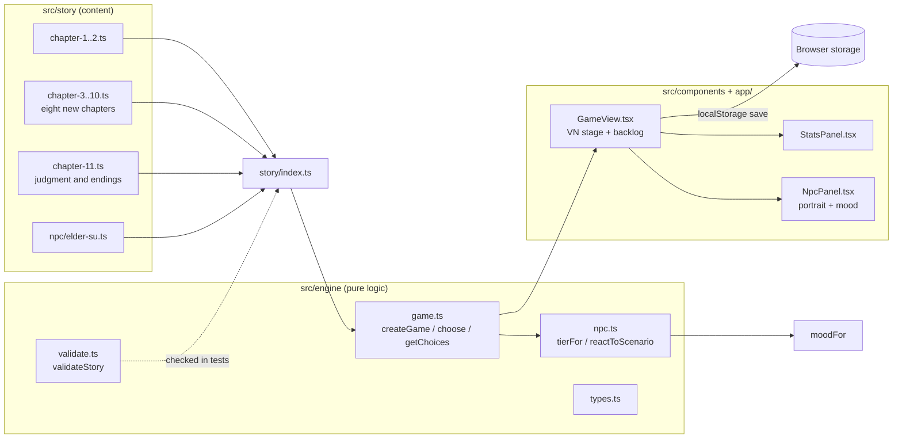
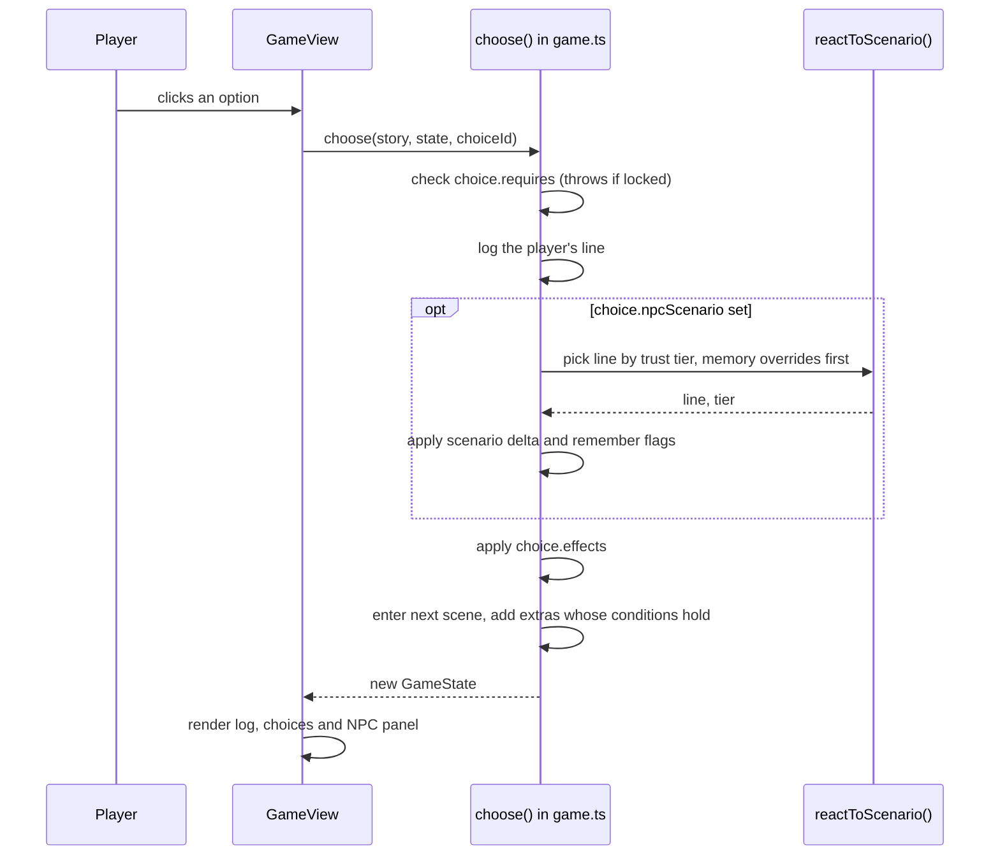
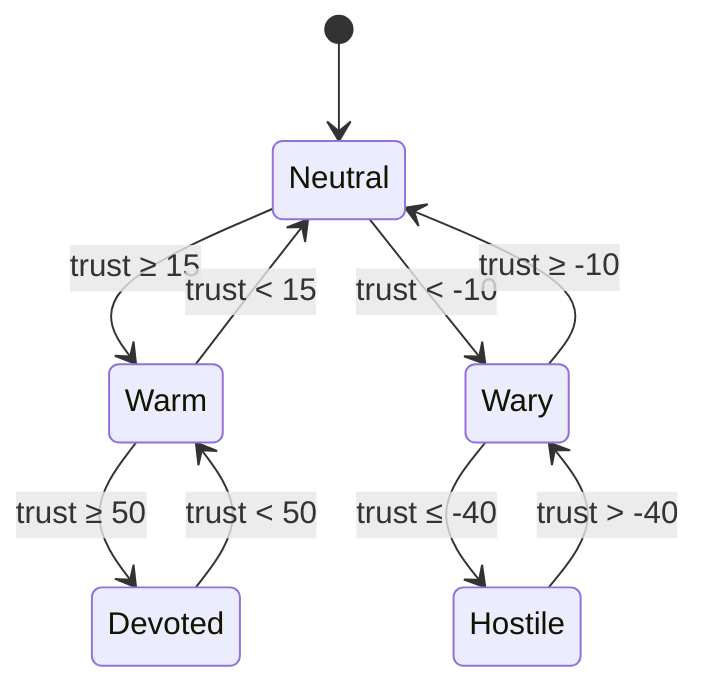
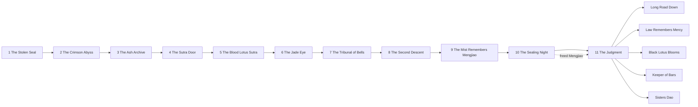
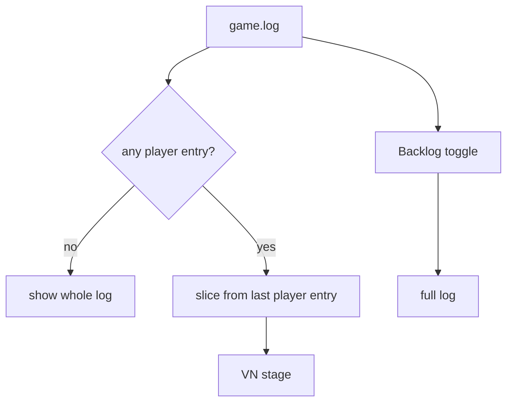

# Architecture

The game is split into a pure story engine and a thin React shell. The engine has no React or DOM dependencies, so every rule is covered by unit tests.

## Turn flow

Every choice goes through the same path. The NPC reacts before the next scene is entered, so her line is the last thing the player reads before the new text.

## NPC attitude model

Trust chooses the tier. Memory flags can override the tier line when the NPC remembers something the player did earlier.

## Chapter map

Reading order is set in `src/story/index.ts`. Each chapter ends by linking into the next one's first scene. The judgment in chapter eleven has five endings, and the Sisters’ Dao ending needs Mengjiao freed on the Sealing Night.

## Visual novel stage

The stage shows only the current beat. `currentBeat` starts at the player’s latest choice, so the previous scene is hidden. The backlog shows the full log.

## Scenarios

The Elder reacts to thirty-six scenarios. Each has five tier lines. Some have memory overrides. Scenes can also carry NPC interjections, which she speaks unprompted when her metrics or flags cross a threshold.

The table lists the original fifteen. The other twenty-one are in `src/story/npc/elder-su.ts`.

| Scenario | Triggered by | Memory override |
| --- | --- | --- |
| GIFT_HERB | Offering a spirit herb at the gate | — |
| HONEST_ACCOUNT | Telling the truth | `lied_about_seal` |
| LIE_ABOUT_SEAL | Denying the theft | — |
| THREATEN | Threatening the elder | — |
| SHOW_MERCY | Sparing Gu Hanzhen | — |
| STEAL_SCROLL | Taking the Heavenly Scroll | — |
| REVEAL_DEMONIC_QI | Using the black lotus | — |
| ASK_FORBIDDEN_ART | Asking about the Blood Lotus Sutra | — |
| INSULT_SECT | Mocking the Law | — |
| HONOR_ANCESTORS | Kneeling at the tablets | — |
| REFUSE_TASK | Refusing the mission | `stole_scroll` |
| COMPLETE_TASK | Returning the jade | `spared_gu` |
| EXPOSE_HER_SECRET | Revealing Su Mengjiao | — |
| SWEAR_OATH | Swearing a Dao oath | `demonic_glimpsed` |
| ACCEPT_PUNISHMENT | Accepting judgment | `exposed_elder` |

## Quality gates

- `npm test` checks that every decision has at least four choices, that every link resolves, that there are at least ten NPC scenarios, and that each scenario produces five distinct replies.
- `npm run word-count` reports player-facing words against the 1,000,000-word goal.
- CI (`.github/workflows/ci.yml`) runs lint, typecheck, tests, word count, and the production build.
